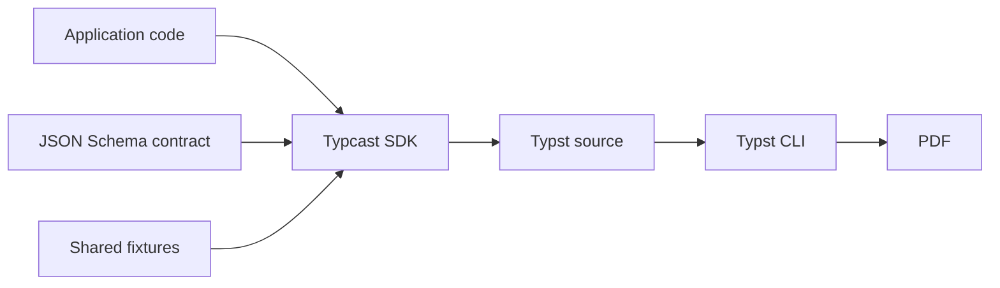
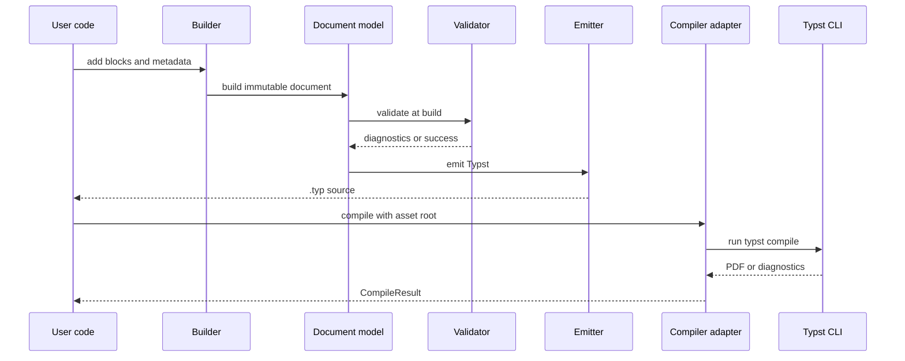
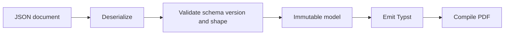

# Architecture overview

Status: CONFIRMED
Scope: Normative
Last updated: 2026-11-24

## System context

Typcast sits between application code and the Typst compiler. Application code
constructs a document through a typed builder. The SDK validates the resulting
immutable model, emits deterministic Typst source, and optionally invokes an
installed Typst CLI to produce a PDF.

The SDK does not host a rendering service and does not bundle the compiler. The
compiler remains an external executable with an explicit compatibility range.

## Design principles

1. The document model is the contract. Builders are constructors.
2. The schema is normative for data and serialization.
3. Emitter and builder behavior are defined by shared fixtures, not by the
   schema alone.
4. Python and TypeScript must produce the same `.typ` bytes for the same input.
5. Validation is two-phase: at `build()` and again before emit or compile.
6. The compiler is isolated behind an adapter and never invoked through a shell.
7. Raw Typst is a deliberate escape hatch and is treated as trusted input.
8. Generated artifacts live in the Bazel output tree and are never edited.

## Components

| Component | Responsibility | Current state |
|---|---|---|
| Contract sources | JSON Schema templates, static schemas, CSV catalogs | Partial and inconsistent; see `specifications/schema.md`. |
| Code generator | Expand CSV placeholders into JSON Schema | Implemented in `tools/codegen/`. |
| Bazel rules | Build schema artifacts and package targets | Schema rules implemented; packaging rules absent. |
| Python SDK | Model, builder, validation, emitter, compiler adapter | Placeholder package. |
| TypeScript SDK | Model, builder, validation, emitter, compiler adapter | Placeholder package. |
| Shared fixtures | Cross-language documents and expected `.typ` output | Directory placeholders only. |
| Compiler adapter | Discover, validate, execute, and map Typst CLI results | Not implemented. |
| Documentation | Product, contract, and engineering specifications | This document set. |

## Data flow

### Builder path

### JSON path

The JSON path is important for services that receive documents from another
process. It uses the same model and emitter as the builder path.

## Trust boundaries

| Boundary | Trust level | Control |
|---|---|---|
| Application data | Untrusted | Schema validation and typed builder arguments. |
| Raw Typst | Trusted | Documented as an escape hatch; not parsed or sandboxed by Typcast. |
| Asset root | User-controlled | Relative paths, normalization, traversal rejection, symlink checks. |
| Compiler executable | User-controlled | Explicit path or PATH lookup, version check, no shell, timeout. |
| Compiler workspace | Temporary | Isolated directory containing only the generated source and copied assets. |
| Package registry | External | Lockfiles, checksums, review, and release gates. |

Raw Typst can express operations that Typst itself permits, including file reads
inside the compiler root. Typcast does not claim to make untrusted raw Typst
safe. Applications that accept raw Typst from untrusted users must run the
compiler in an additional sandbox.

## Failure boundaries

| Failure | Boundary | Result |
|---|---|---|
| Invalid builder argument | Public API | `TYPCAST-API-*` error. |
| Invalid document shape | Validation | `TYPCAST-VAL-*` diagnostics. |
| Invalid JSON or schema version | Deserialization | `TYPCAST-IR-*` diagnostics. |
| Emitter invariant failure | Emitter | `TYPCAST-EMIT-*` error. |
| Missing compiler or unsupported version | Compiler adapter | `TYPCAST-COMPILER-*` error. |
| Missing or unsafe asset | Asset resolver | `TYPCAST-IO-*` error. |
| Typst syntax or layout failure | Typst CLI | `TYPCAST-COMPILER-*` diagnostic with raw compiler output. |

## Architecture requirements

| ID | Requirement | Status | Verification |
|---|---|---|---|
| ARC-001 | Python and TypeScript MUST share the same document IR and conformance fixtures. | CONFIRMED | Parity test. |
| ARC-002 | JSON Schema MUST be normative for document data; builders MUST remain idiomatic per language. | CONFIRMED | Schema and API review. |
| ARC-003 | Documents MUST be validated at `build()` and again before emit or compile. | CONFIRMED | Validation tests. |
| ARC-004 | The emitter MUST be deterministic for a given model and product version. | CONFIRMED | Golden tests. |
| ARC-005 | The compiler MUST be accessed through an adapter and MUST NOT be bundled in the MVP. | CONFIRMED | Compiler tests. |
| ARC-006 | The compiler MUST be invoked without shell string interpolation. | CONFIRMED | Code review and command-capture test. |
| ARC-007 | Compilation MUST run in an isolated temporary workspace. | CONFIRMED | Workspace test. |
| ARC-008 | The SDK MUST NOT require network access to build or emit a document. | CONFIRMED | Offline test. |
| ARC-009 | Raw Typst MUST be treated as trusted input and documented as such. | CONFIRMED | Security review. |
| ARC-010 | Generated artifacts MUST NOT be edited in the source tree. | CONFIRMED | Build review. |
| ARC-011 | Bazel MUST remain the primary build system for repository targets. | CONFIRMED | Build verification. |
| ARC-012 | Python and TypeScript packages MUST be independently installable. | CONFIRMED | Install tests. |
| ARC-013 | Diagnostics MUST use the shared structured taxonomy. | CONFIRMED | Diagnostics parity test. |
| ARC-014 | A new node MUST be addable in a minor schema version; older readers MUST reject documents that use it instead of silently dropping it. | CONFIRMED | Schema compatibility review. |
| ARC-015 | The architecture MUST preserve a path to Post-MVP compiler backends without changing the public model. | CONFIRMED | ADR review. |

## Current state and target state

| Area | Current | Target |
|---|---|---|
| Contract | Prototype schemas with missing references and double nesting. | Coherent draft 2020-12 schemas generated from templates. |
| SDK | Empty packages. | Immutable model, builder, validation, emitter, compiler adapter. |
| Compiler | No integration. | Typst CLI adapter with version range and timeout. |
| Packaging | No artifacts. | Wheel, sdist, npm tarball, schema archive, versioned raw schema URLs. |
| CI | No workflows. | PR, main, and release workflows. |

## Open questions

- Should the compiler adapter expose a pluggable backend interface in the MVP,
  or only the Typst adapter behind an internal interface?
- Should shared fixtures live under `tests/fixtures` or under a versioned
  `specs/conformance` package?
- Should the SDK expose a low-level IR constructor in addition to the builder?

## Related documents

- [Repository architecture](repository.md)
- [Document IR](../specifications/document-ir.md)
- [SDK API](../specifications/sdk-api.md)
- [Compiler adapter](../specifications/compiler.md)
- [Security](../development/security.md)
