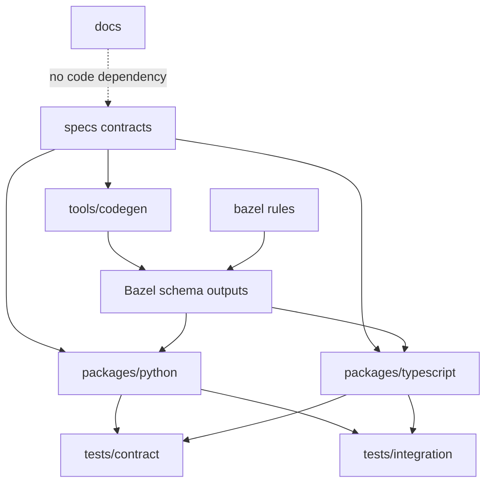

# Repository architecture

Status: CONFIRMED
Scope: Normative
Last updated: 2026-11-24

## Purpose

This document defines repository boundaries, dependency direction, and Bazel
package responsibilities. The repository is a Bazel monorepo, but only the
schema generator is implemented today. The layout is intentionally modular so
that the Python SDK, TypeScript SDK, fixtures, and tooling can evolve without
creating circular dependencies.

## Repository layout

| Path | Responsibility | Current state |
|---|---|---|
| `specs/catalogs/` | Language-independent CSV catalogs for enums. | Implemented. |
| `specs/schemas/` | Static schemas, schema templates, and the bundle validation test. | The bundle implements the document IR and passes the contract test. |
| `tools/codegen/` | Python generator for template and CSV expansion. | Implemented with seven unit tests. |
| `tools/publish/` | Python publisher for the released schema bundle. | Implemented with 23 unit tests. |
| `bazel/` | Reusable Starlark rules. | Schema and publication rules implemented. |
| `packages/python/` | Python SDK. | Placeholder package. |
| `packages/typescript/` | TypeScript and JavaScript SDK. | Placeholder package; manifest is private. |
| `tests/contract/` | Cross-language contract tests. | Placeholder directory. |
| `tests/integration/` | Compiler, filesystem, and install tests. | Placeholder directory. |
| `examples/python/` | Python examples. | Placeholder directory. |
| `examples/typescript/` | TypeScript examples. | Placeholder directory. |
| `scripts/` | Repository automation. | Documentation and workflow checks, and the release version check. |
| `docs/` | Product, architecture, contract, and engineering docs. | This document set. |
| `.github/PULL_REQUEST_TEMPLATE.md` | The single pull request template. | Present. |
| `.github/workflows/` | CI and release workflows. | Three workflows: pull request validation, main integration, and release verification. |
| `CONTRIBUTING.md` | The contributing guide. | Present. |
| `CODE_OF_CONDUCT.md` | The code of conduct, Contributor Covenant 2.1. | Present. |
| `CHANGELOG.md` | The changelog, Keep a Changelog style. | Present. |

## Dependency direction



The arrows describe allowed dependencies, not current implementation. The
following rules are normative:

- `specs/` MUST NOT depend on an SDK implementation.
- The Python SDK MUST NOT depend on the TypeScript SDK.
- The TypeScript SDK MUST NOT depend on the Python SDK.
- Both SDKs MUST depend on the same versioned contract artifacts.
- Cross-language tests MAY depend on both SDKs.
- Documentation MUST NOT be required to build an SDK package.
- The code generator MUST NOT import SDK code.

## Package responsibilities

### `specs/`

The contract layer. It owns schema templates, static schema fragments, and enum
catalogs. It also owns `specs/schemas/schema_tests.py`, the bundle validation
target that checks the built bundle against the contract. It does not own
builder behavior or emitter behavior. A change to a catalog that changes a
public enum is a contract change.

### `tools/codegen/`

A standalone Python package that expands placeholders in JSON templates. It
validates JSON syntax, not JSON Schema semantics or `$ref` resolution. It must
remain independent of the SDKs so that schema generation can run before either
SDK exists.

### `packages/python/`

The Python distribution named `typcast`. Proposed internal modules:

| Module | Responsibility |
|---|---|
| `typcast.models` | Immutable model types and public constructors. |
| `typcast.builder` | Fluent builder. |
| `typcast.validation` | Schema and semantic validation. |
| `typcast.typst` | Typst emitter and escaping. |
| `typcast.compiler` | Typst CLI adapter. |
| `typcast.diagnostics` | Diagnostic types and code catalog. |
| `typcast.config` | Compile and asset configuration. |
| `typcast.serialization` | JSON IR serialization and deserialization. |

The current `models/`, `typst/`, and `validations/` directories are placeholders.
The final module names may differ, but the public import path MUST remain
`typcast`.

### `packages/typescript/`

The npm distribution named `typcast`. Proposed source modules mirror the Python
responsibilities. The package MUST expose ESM entry points, type declarations,
and compiled JavaScript. The current `package.json` name is
`@zuudevs/typcast`; this must be changed to `typcast` before publication.

### `tests/`

Shared conformance and integration tests. Proposed structure:

```text
tests/
  fixtures/
    documents/
    expected/
  contract/
  integration/
```

Fixtures are language-neutral JSON documents. Expected `.typ` files are shared
by both SDKs. Test code may be language-specific, but the inputs and expected
outputs are not.

### `bazel/`

Reusable Starlark rules. Rules must declare their inputs explicitly. In
particular, every CSV used by a template must be listed in the `catalogs`
attribute of the schema rule. Sandbox correctness depends on this.

## Bazel targets

Current targets include:

| Target | Purpose |
|---|---|
| `//tools/codegen:typcast_codegen` | Generator binary. |
| `//tools/codegen:typcast_codegen_lib` | Generator library. |
| `//tools/codegen/tests:unit_tests` | Seven generator unit tests. |
| `//tools/publish:publish_schemas` | Publisher binary. |
| `//tools/publish:publish_schemas_lib` | Publisher library. |
| `//tools/publish/tests:publish_tests` | Forty-one publisher unit tests. |
| `//scripts:docs_checks` | Documentation, requirement, and decision checks. |
| `//specs/schemas:schema_bundle` | Six staged or generated schema files. |
| `//specs/schemas:schema_manifest` | The names of the bundle files. |
| `//specs/schemas:archive` | The deterministic archive of the bundle. |
| `//specs/schemas:schema_tests` | Validates the built bundle against the schema contract. |
| `//packages/python:typcast` | Python library placeholder. |
| `//packages/typescript:typcast` | TypeScript project placeholder. |

The MVP must add packaging targets for the Python wheel and sdist and for the
npm tarball. The schema archive target exists. Target names are specified in
`development/release.md`.

## Generated artifacts

- Generated schemas are written under `bazel-bin/specs/schemas/`.
- Generated artifacts MUST NOT be committed to the development branch.
- The published schema bundle is the only exception. The release commit
  publishes it under `specs/schemas/` so that the versioned raw URLs resolve.
- Source schemas and templates remain under `specs/schemas/`.
- Static schemas are staged with `typcast_schema_copy`, which uses a symlink
  action. Builds that require portable archives must dereference or package the
  files explicitly.

## Requirements

| ID | Requirement | Status | Verification |
|---|---|---|---|
| REPO-001 | The repository MUST remain a Bazel monorepo. | CONFIRMED | `bazel build //...`. |
| REPO-002 | `specs/` MUST NOT depend on SDK code. | CONFIRMED | Dependency review. |
| REPO-003 | Python and TypeScript SDKs MUST NOT depend on each other. | CONFIRMED | Dependency review. |
| REPO-004 | Both SDKs MUST consume the same contract version. | CONFIRMED | Version check. |
| REPO-005 | Shared fixtures MUST be language-neutral. | CONFIRMED | Fixture review. |
| REPO-006 | Every template CSV MUST be declared in the Bazel rule. | CONFIRMED | Build and sandbox test. |
| REPO-007 | Generated artifacts MUST NOT be committed to the development branch; the published schema bundle MUST be committed only in the tagged release commit (`REL-030`). | CONFIRMED | `.gitignore` and review. |
| REPO-008 | The Python import path MUST be `typcast`. | CONFIRMED | Import test. |
| REPO-009 | The npm package name MUST be `typcast` before publication. | CONFIRMED | Manifest check. |
| REPO-010 | Documentation checks MUST NOT require SDK installation. | CONFIRMED | Docs CI. |
| REPO-011 | New Python package directories MUST contain `__init__.py`. | CONFIRMED | Bazel build. |
| REPO-012 | TypeScript compiler version MUST come from the root `package.json`. | CONFIRMED | Bazel configuration review. |

## Current gaps

| Gap | Impact | Owner |
|---|---|---|
| TS package name mismatch | Publication would use the wrong name. | TypeScript SDK |
| No shared fixtures | Parity cannot be tested. | Testing |
| No packaging targets | Release cannot produce artifacts. | Release |

## Open questions

- Should `tests/fixtures` be a Bazel package with exported files, or a source
  directory consumed by test rules?
- Should the Python and TypeScript SDKs share generated type definitions, or
  only the JSON Schema?
- Should `packages/typescript` publish compiled JavaScript only, or source maps
  as well?

## Related documents

- [Architecture overview](overview.md)
- [Schema contract](../specifications/schema.md)
- [Build](../development/build.md)
- [Testing](../development/testing.md)
- [Release](../development/release.md)
