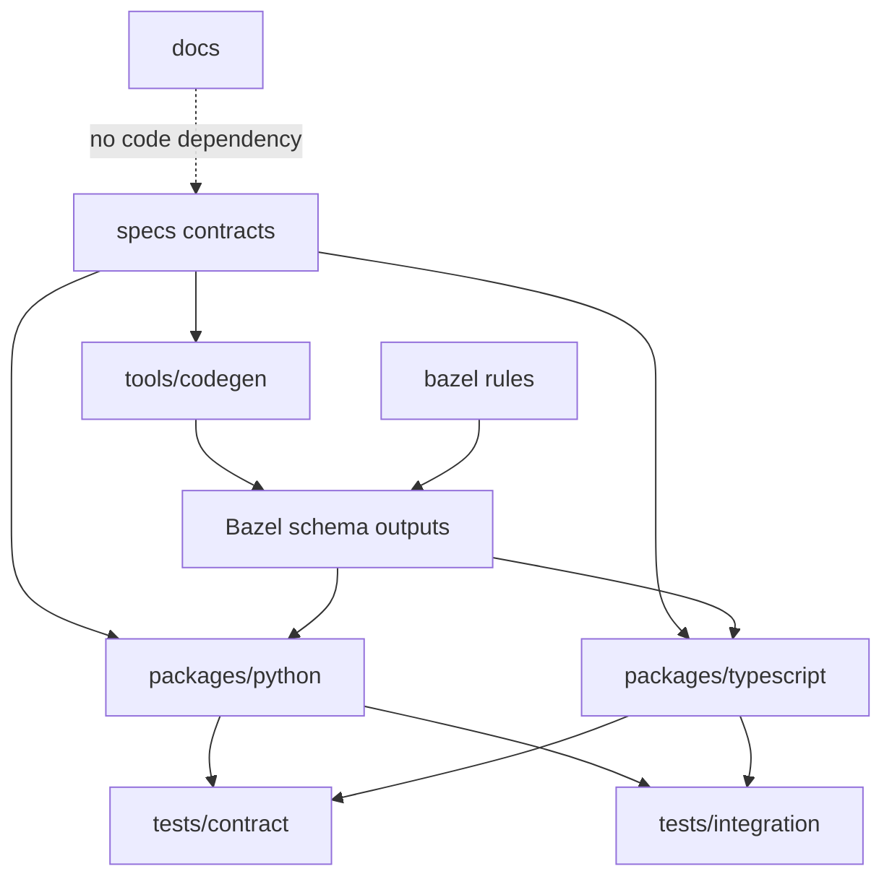

# Repository architecture

Status: CONFIRMED
Scope: Normative
Last updated: 2026-11-25

## Purpose

This document defines repository boundaries, dependency direction, and Bazel
package responsibilities. The repository is a Bazel monorepo, but only the
schema generator is implemented today. The layout is intentionally modular so
that the Python SDK, TypeScript SDK, fixtures, and tooling can evolve without
creating circular dependencies.

## Repository layout

| Path | Responsibility | Current state |
|---|---|---|
| `specs/catalogs/` | Language-independent CSV catalogs for enums. | Implemented. |
| `specs/schemas/` | Static schemas, schema templates, and the bundle validation test. | The bundle implements the document IR and passes the contract test. |
| `tools/codegen/` | Python generator for template and CSV expansion. | Implemented with seven unit tests. |
| `tools/publish/` | Python publisher for the released schema bundle. | Implemented with 23 unit tests. |
| `bazel/` | Reusable Starlark rules. | Schema and publication rules implemented. |
| `packages/python/` | Python SDK. | Implemented: the immutable document model, the diagnostics, and the JSON serialization. |
| `packages/typescript/` | TypeScript and JavaScript SDK. | Implemented: the immutable document model, the diagnostics, and the JSON serialization. The manifest is named `typcast` and is still private. |
| `tests/contract/` | Cross-language contract tests. | Implemented: the Python and the TypeScript runners read the shared fixtures. |
| `tests/fixtures/` | Shared language-neutral fixtures. | Implemented: the document IR fixtures and their manifest. |
| `tests/integration/` | Compiler, filesystem, and install tests. | Placeholder directory. |
| `examples/python/` | Python examples. | Placeholder directory. |
| `examples/typescript/` | TypeScript examples. | Placeholder directory. |
| `scripts/` | Repository automation. | Documentation and workflow checks, the release version check, and the release preparation. |
| `docs/` | Product, architecture, contract, and engineering docs. | This document set. |
| `.github/PULL_REQUEST_TEMPLATE.md` | The single pull request template. | Present. |
| `.github/workflows/` | CI and release workflows. | Three workflows: pull request validation, main integration, and release verification. |
| `CONTRIBUTING.md` | The contributing guide. | Present. |
| `CODE_OF_CONDUCT.md` | The code of conduct, Contributor Covenant 2.1. | Present. |
| `CHANGELOG.md` | The changelog, Keep a Changelog style. | Present. |

## Dependency direction



The arrows describe allowed dependencies, not current implementation. The
following rules are normative:

- `specs/` MUST NOT depend on an SDK implementation.
- The Python SDK MUST NOT depend on the TypeScript SDK.
- The TypeScript SDK MUST NOT depend on the Python SDK.
- Both SDKs MUST depend on the same versioned contract artifacts.
- Cross-language tests MAY depend on both SDKs.
- Documentation MUST NOT be required to build an SDK package.
- The code generator MUST NOT import SDK code.

The rules are checked by `//scripts:repository_checks`, which reads the source
tree of the repository. The check also covers the build structure, the
toolchain pins, the security configuration, the npm package name, and the
scope document of the repository.

## Package responsibilities

### `specs/`

The contract layer. It owns schema templates, static schema fragments, and enum
catalogs. It also owns `specs/schemas/schema_tests.py`, the bundle validation
target that checks the built bundle against the contract. It does not own
builder behavior or emitter behavior. A change to a catalog that changes a
public enum is a contract change.

### `tools/codegen/`

A standalone Python package that expands placeholders in JSON templates. It
validates JSON syntax, not JSON Schema semantics or `$ref` resolution, and it
rejects the constants that JSON does not define, such as `NaN` and `Infinity`.
It must remain independent of the SDKs so that schema generation can run
before either SDK exists.

### `packages/python/`

The Python distribution named `typcast`. The modules of the first release are:

| Module | Responsibility |
|---|---|
| `typcast.models` | Immutable model types and public constructors. |
| `typcast.diagnostics` | Diagnostic types and code catalog. |
| `typcast.serialization` | JSON IR serialization and deserialization. |
| `typcast.version` | The schema version of the document IR and the version rules. |
| `typcast.builder` | Fluent builder. Not implemented. |
| `typcast.validation` | Schema and semantic validation. Not implemented. |
| `typcast.typst` | Typst emitter and escaping. Not implemented. |
| `typcast.compiler` | Typst CLI adapter. Not implemented. |
| `typcast.config` | Compile and asset configuration. Not implemented. |

The public import path MUST remain `typcast`. The final module names may differ,
but the public import path MUST NOT change.

### `packages/typescript/`

The npm distribution named `typcast`. The source modules mirror the Python
responsibilities: `src/models/` holds the immutable model types, `src/diagnostics.ts`
holds the diagnostic types and the code catalog, `src/serialization.ts` holds the
JSON IR serialization and deserialization, and `src/version.ts` holds the schema
version and the version rules. The package MUST expose ESM entry points, type
declarations, and compiled JavaScript. The current `package.json` name is
`typcast`, and the repository checks reject a different name. The manifest is
still `private`, and that must change before publication.

### `tests/`

Shared conformance and integration tests. The implemented structure is:

```text
tests/
  fixtures/
    BUILD.bazel
    documents/
      manifest.json
      minimal.json
      full.json
      nested.json
      empty-collections.json
      modules.json
      unicode.json
      patch-version.json
      ...negative fixtures
  contract/
    BUILD.bazel
    contract.test.mts
    node_shims.d.ts
    test_contract.py
```

Fixtures are language-neutral JSON documents. Expected `.typ` files are shared
by both SDKs. Test code may be language-specific, but the inputs and expected
outputs are not. The `manifest.json` of the fixture directory names every valid
fixture and every negative fixture with the diagnostic code that the fixture
must produce, so both SDKs check the same expectation.

### `bazel/`

Reusable Starlark rules. Rules must declare their inputs explicitly. In
particular, every CSV used by a template must be listed in the `catalogs`
attribute of the schema rule. Sandbox correctness depends on this.

## Bazel targets

Current targets include:

| Target | Purpose |
|---|---|
| `//tools/codegen:typcast_codegen` | Generator binary. |
| `//tools/codegen:typcast_codegen_lib` | Generator library. |
| `//tools/codegen/tests:unit_tests` | Sixteen generator unit tests. |
| `//tools/publish:publish_schemas` | Publisher binary. |
| `//tools/publish:publish_schemas_lib` | Publisher library. |
| `//tools/publish/tests:publish_tests` | Forty-five publisher unit tests. |
| `//scripts:docs_checks` | Documentation, requirement, and decision checks. |
| `//scripts:check_links` | External link check of the documents. |
| `//scripts:prepare_release` | Prepares the release commit of a release. |
| `//scripts:repository_checks` | Repository structure, dependency, and toolchain checks. |
| `//scripts/tests:docs_tests` | Thirty-two documentation check tests. |
| `//scripts/tests:link_tests` | Four external link check tests. |
| `//scripts/tests:release_flow_tests` | Six release rehearsal tests. |
| `//scripts/tests:release_tests` | Twenty release preparation tests. |
| `//scripts/tests:repository_tests` | Forty-three repository structure check tests. |
| `//specs/schemas:schema_bundle` | Six staged or generated schema files. |
| `//specs/schemas:schema_manifest` | The names of the bundle files. |
| `//specs/schemas:archive` | The deterministic archive of the bundle. |
| `//specs/schemas:schema_tests` | Validates the built bundle against the schema contract. |
| `//specs/schemas:release_tag_tests` | Validates the release tag pattern of the schema contract. |
| `//packages/python:typcast` | Python SDK library with the immutable document model. |
| `//packages/python/tests:model_tests` | Forty-five document model unit tests. |
| `//packages/typescript:typcast` | TypeScript project with the immutable document model. |
| `//packages/typescript:model_test_run` | Document model unit tests of the TypeScript SDK. |
| `//tests/fixtures:documents` | The shared document IR fixtures. |
| `//tests/contract:contract_py` | The Python contract runner. |
| `//tests/contract:contract_ts_test` | The TypeScript contract runner. |

The MVP must add packaging targets for the Python wheel and sdist and for the
npm tarball. The schema archive target exists. Target names are specified in
`development/release.md`.

## Generated artifacts

- Generated schemas are written under `bazel-bin/specs/schemas/`.
- Generated artifacts MUST NOT be committed to the development branch.
- The published schema bundle is the only exception. The release commit
  publishes it under `specs/schemas/` so that the versioned raw URLs resolve,
  and the preparation command removes the generated files again afterwards.
- Source schemas and templates remain under `specs/schemas/`.
- Static schemas are staged with `typcast_schema_copy`, which uses a symlink
  action. Builds that require portable archives must dereference or package the
  files explicitly.

## Requirements

| ID | Requirement | Status | Verification |
|---|---|---|---|
| REPO-001 | The repository MUST remain a Bazel monorepo. | IMPLEMENTED | `bazel build //...` passes; `//scripts:repository_checks` rejects a source file that belongs to no Bazel package and a source file in the root package. |
| REPO-002 | `specs/` MUST NOT depend on SDK code. | IMPLEMENTED | `//scripts:repository_checks` rejects a module of `specs/` that imports the SDK package. |
| REPO-003 | Python and TypeScript SDKs MUST NOT depend on each other. | IMPLEMENTED | `//scripts:repository_checks` rejects an import that leaves the package of the SDK it belongs to. |
| REPO-004 | Both SDKs MUST consume the same contract version. | IMPLEMENTED | `//tests/contract:contract_py` and `//tests/contract:contract_ts_test`; every runner checks the schema version of the fixtures against the version of its own SDK. |
| REPO-005 | Shared fixtures MUST be language-neutral. | IMPLEMENTED | The fixtures under `tests/fixtures/documents/` are language-neutral JSON; `//tests/contract:contract_py` and `//tests/contract:contract_ts_test` read the same files. |
| REPO-006 | Every template CSV MUST be declared in the Bazel rule. | IMPLEMENTED | The generator rejects a placeholder whose catalog is not declared as an input of the rule; `//tools/codegen/tests:unit_tests`. |
| REPO-007 | Generated artifacts MUST NOT be committed to the development branch; the published schema bundle MUST be committed only in the tagged release commit (`REL-030`). | IMPLEMENTED | `//scripts:repository_checks` rejects committed generated schemas unless every manifest, every schema source, and the changelog agree on the release version. |
| REPO-008 | The Python import path MUST be `typcast`. | IMPLEMENTED | `//scripts:repository_checks` reads the project name of `packages/python/pyproject.toml` and the package directory `packages/python/src/typcast`. |
| REPO-009 | The npm package name MUST be `typcast` before publication. | IMPLEMENTED | `//scripts:repository_checks` reads `packages/typescript/package.json` and rejects a name other than `typcast`. |
| REPO-010 | Documentation checks MUST NOT require SDK installation. | IMPLEMENTED | `//scripts:repository_checks` rejects a module of `scripts/` that imports the SDK package. |
| REPO-011 | New Python package directories MUST contain `__init__.py`. | IMPLEMENTED | `//scripts:repository_checks` rejects a package directory that holds Python modules but no `__init__.py`. |
| REPO-012 | TypeScript compiler version MUST come from the root `package.json`. | IMPLEMENTED | `//scripts:repository_checks` reads the root manifest, the SDK manifest, and the module file of Bazel. |

## Current gaps

| Gap | Impact | Owner |
|---|---|---|
| No builder API | The SDKs expose the model but no fluent construction surface. | SDK |
| No emitter and no compiler adapter | A document cannot be turned into Typst or into a PDF. | SDK |
| No packaging targets | Release cannot produce artifacts. | Release |
| No golden `.typ` fixtures | The emitter output cannot be compared byte for byte. | Testing |

## Open questions

- Should the Python and TypeScript SDKs share generated type definitions, or
  only the JSON Schema?
- Should `packages/typescript` publish compiled JavaScript only, or source maps
  as well?

## Related documents

- [Architecture overview](overview.md)
- [Schema contract](../specifications/schema.md)
- [Build](../development/build.md)
- [Testing](../development/testing.md)
- [Release](../development/release.md)
