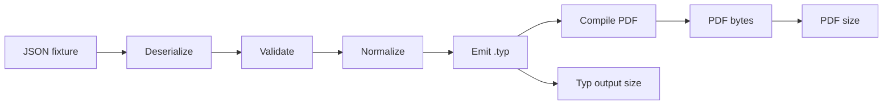

# Benchmarking

Status: PROPOSED
Scope: Normative
Last updated: 2026-11-24

## Purpose

The MVP must establish a performance baseline for the document pipeline. The
benchmark harness measures validation, normalization, Typst emission, compiler
time, and package footprint. It is separate from correctness tests and does not
fail a pull request in the MVP.

## Current state

There is no benchmark harness, fixture set, baseline file, or performance test.
No performance claim is currently verified.

## Workloads

| Fixture | Description | Approximate content |
|---|---|---|
| `minimal` | One heading and one paragraph. | Smallest valid document. |
| `report-small` | One page report with a table and image. | 5 to 10 blocks. |
| `report-medium` | Multi-section report. | 30 to 50 blocks, 2 tables, 2 images. |
| `report-large` | Long report with repeated sections. | 200 or more blocks, 10 tables, 10 images. |
| `invoice` | Invoice with line items and totals. | 1 table with many rows. |
| `raw` | Document with raw Typst blocks. | 10 raw blocks. |

Fixtures are shared with correctness tests. Benchmark fixtures may be larger than
golden fixtures, but they must remain deterministic.

## Stages



| Stage | Measured operation | Requires compiler |
|---|---|---|
| Deserialization | JSON to model. | No |
| Validation | Schema and semantic validation. | No |
| Normalization | Defaults and canonical model construction. | No |
| Emission | Model to `.typ`. | No |
| Compilation | `.typ` to PDF. | Yes |
| Package footprint | Wheel, sdist, npm tarball, schema archive size. | No |

## Metrics

| Metric | Unit | Notes |
|---|---|---|
| Wall time | milliseconds | Median and p95 over repetitions. Required. |
| Peak memory | MiB | Optional. Measured on Linux only, where the measurement is reliable. |
| `.typ` size | bytes | Deterministic. |
| PDF size | bytes | Compiler-dependent. |
| Package size | bytes | Per artifact and total. |
| Compiler version | string | Recorded with every compiler result. |

CPU time and allocation counts are Post-MVP unless a dependency-free measurement
is available.

## Methodology

- Run on a dedicated CI runner or a documented local machine.
- Use the same fixture bytes for Python and TypeScript.
- Warm up once before measurement.
- Run at least five repetitions.
- Report median and p95, not only the mean.
- Keep correctness tests separate from benchmark runs.
- Disable network access during benchmarks.
- Record the git commit, branch, and dirty state.
- Record whether the build is debug or optimized.
- Do not compare results across different machines without a warning.
- Do not use benchmark results as a hard gate until the baseline is stable.

## Baseline format

```json
{
  "formatVersion": "1",
  "createdAt": "2026-11-24T00:00:00Z",
  "commit": "0000000",
  "environment": {
    "os": "windows",
    "arch": "x64",
    "cpu": "Example CPU",
    "memoryMiB": 16384,
    "python": "3.14.0",
    "node": "22.0.0",
    "typst": "0.15.1",
    "bazel": "9.3.3",
    "buildMode": "opt"
  },
  "results": [
    {
      "fixture": "report-medium",
      "stage": "emit",
      "runtime": "python",
      "repetitions": 5,
      "medianMs": 12.4,
      "p95Ms": 14.1,
      "peakMemoryMiB": 42.0,
      "outputBytes": 8123
    }
  ]
}
```

Baseline files are stored under `benchmarks/baseline/` with a name that includes
the platform and date. This path is `PROPOSED`.

## Reporting

The benchmark job publishes:

- A JSON baseline artifact, retained for 90 days.
- A human-readable summary in the CI log.
- A comparison against the previous baseline when available.
- A warning when the median wall time regresses by more than 10 percent against
  the stored baseline for the same fixture, stage, runtime, and platform.

The 10 percent threshold is a warning, not a hard failure, in the MVP. A
regression warning is recorded in the benchmark summary and linked to the
commit that caused it.

## Package footprint

Measure:

- Wheel size.
- Source distribution size.
- npm tarball size.
- Schema archive size.
- Installed runtime dependency count.
- Uncompressed installed size.

Package footprint is measured from release artifacts, not from the source tree.

## Requirements

| ID | Requirement | Status | Verification |
|---|---|---|---|
| PERF-001 | The MVP MUST have a benchmark harness for validation, normalization, emission, compilation, and package size. | CONFIRMED | Harness review. |
| PERF-002 | Benchmarks MUST use shared small, medium, and large fixtures. | CONFIRMED | Fixture review. |
| PERF-003 | Benchmarks MUST record wall time and output size. | CONFIRMED | Result schema. |
| PERF-004 | Benchmarks SHOULD record peak memory on Linux, where the measurement is reliable. | CONFIRMED | Result schema. |
| PERF-005 | Benchmarks MUST record environment metadata. | CONFIRMED | Result schema. |
| PERF-006 | Benchmarks MUST run on main and release, not every PR. | CONFIRMED | CI review. |
| PERF-007 | Benchmarks MUST NOT be a hard release gate in the MVP. | CONFIRMED | Release review. |
| PERF-008 | Benchmarks MUST use at least five repetitions. | CONFIRMED | Harness review. |
| PERF-009 | Benchmarks MUST report median and p95. | CONFIRMED | Harness review. |
| PERF-010 | Benchmarks MUST NOT require network access. | CONFIRMED | CI review. |
| PERF-011 | Package footprint MUST be measured from release artifacts. | CONFIRMED | Release review. |
| PERF-012 | Benchmark results MUST be retained as CI artifacts for 90 days. | CONFIRMED | CI review. |
| PERF-013 | A median wall-time regression of more than 10 percent against the stored baseline MUST produce a warning and MUST NOT fail the build. | CONFIRMED | Benchmark comparison. |
| PERF-014 | Benchmark results MUST NOT include document content or secrets. | CONFIRMED | Review. |
| PERF-015 | Benchmark methodology MUST be documented with its limitations. | CONFIRMED | This document. |

## Open questions

- Which CI runner class is stable enough for baseline comparisons?
- Should package footprint be measured per artifact or as a total?
- Should benchmarks include a cold-start measurement?
- Should the 10 percent warning threshold change once the baseline is stable?

## Related documents

- [Testing](testing.md)
- [CI/CD](ci-cd.md)
- [Release](release.md)
- [Build](build.md)
- [ADR-0019](../decisions/ADR-0019-test-and-benchmark-policy.md)
