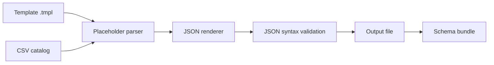

# Build

Status: IMPLEMENTED / OPEN
Scope: Normative for build behavior
Last updated: 2026-11-25

## Purpose

This document defines how to build, test, and generate schema artifacts with
Bazel. It records the commands that are verified in the repository and the known
gaps that must be closed before release.

## Prerequisites

| Tool | Requirement | Evidence |
|---|---|---|
| Bazelisk | Required; reads `.bazelversion`. | `.bazelversion` pins 9.3.3. |
| Git | Required. | Repository tooling. |
| Python for Bazel | Provided by the hermetic toolchain. | `MODULE.bazel` uses Python 3.14. |
| Python for local scripts | Optional; used for audit and validation scripts. | Local environment. |
| Typst CLI | Optional for build; required for compiler tests and PDF. | `typst --version`. |
| Node.js | Required only for TypeScript tooling and consumer tests. | `package.json` requires >=22. |

No separate Python runtime is required for Bazel targets. A local Python runtime
is useful for running the generator outside Bazel and for repository scripts.

## Commands

Build all configured targets:

```shell
bazel build //...
```

Run all tests:

```shell
bazel test //...
```

Run the documentation, requirement, and decision checks:

```shell
bazel test //scripts:docs_checks
```

Build the schema bundle:

```shell
bazel build //specs/schemas:schema_bundle
```

Run the generator with absolute paths:

```shell
bazel run //tools/codegen:typcast_codegen -- --input "$PWD/specs/schemas/templates/api/types/paper.schema.json.tmpl" --output "$PWD/out/paper.schema.json"
```

Run the built binary from the repository root:

```shell
bazel-bin/tools/codegen/typcast_codegen.exe --input specs\schemas\templates\api\types\paper.schema.json.tmpl --output out\paper.schema.json
```

The `bazel run` example in the original README used workspace-relative paths and
failed on Windows. Use absolute paths or the built binary from the repository
root.

## Verified baseline

| Check | Result |
|---|---|
| `bazel build //...` | Pass, 55 targets. |
| `bazel test //...` | Pass, 19 test targets: 16 unittest cases, 45 publisher cases, 15 version cases, 20 release preparation cases, 6 release rehearsal cases, 43 repository structure cases, 4 release tag cases, 32 documentation gate cases, 4 link check cases, 1 documentation check, 1 schema bundle check, 45 document model cases, 6 contract fixture cases, and the TypeScript model, contract, and type-check targets. |
| `bazel build //specs/schemas:schema_bundle` | Pass, 6 schema files. |
| `bazel build //specs/schemas:schema_manifest` | Pass, 6 paths. |
| `bazel build //specs/schemas:archive` | Pass, 6 members, deterministic gzip tarball. |
| `bazel test //specs/schemas:schema_tests` | Pass, 6 bundle files, 0 violations. |
| `bazel test //specs/schemas:release_tag_tests` | Pass, 4 cases. |
| `bazel test //scripts:docs_checks` | Pass, 57 files, 461 requirements, and 3 workflows checked, 0 errors. |
| `bazel test //scripts/tests:version_tests` | Pass, 15 cases. |
| `bazel test //scripts/tests:release_tests` | Pass, 20 cases. |
| `bazel test //scripts/tests:release_flow_tests` | Pass, 6 cases. |
| `bazel run //scripts:repository_checks` | Pass, 2 spec files, 27 SDK files, 13 gate files, 50 Python modules, 11 test modules, 2 toolchain files, 3 TypeScript files, 23 decision records, 73 Bazel package files, 0 errors. |
| `bazel test //scripts/tests:repository_tests` | Pass, 43 cases. |
| `bazel test //scripts/tests:docs_tests` | Pass, 32 cases. |
| `bazel test //scripts/tests:link_tests` | Pass, 4 cases. |
| `bazel test //tools/publish/tests:publish_tests` | Pass, 45 publisher cases. |
| `bazel test //packages/python/tests:model_tests` | Pass, 45 cases. |
| `bazel test //packages/typescript:model_test_run` | Pass. |
| `bazel test //tests/contract:contract_py` | Pass, 6 cases. |
| `bazel test //tests/contract:contract_ts_test` | Pass. |
| `bazel run //scripts:check_links` | Pass, 4 external links checked, 0 unreachable. |
| `bazel query "kind(rule, //...)"` | 59 rules; 19 test targets. |
| `--test_filter` on the unittest target | Ignored; all 16 cases run. |

The schema bundle contains:

```text
bazel-bin/specs/schemas/
  validator.schema.json
  api/types/alignment.schema.json
  api/types/length.schema.json
  api/types/paper.schema.json
  definitions/bound.schema.json
  definitions/node.schema.json
```

## Current targets

`bazel query "kind(rule, //...)"` reports 59 rules. All of them:

| Target | Kind | Purpose |
|---|---|---|
| `//tools/codegen:typcast_codegen` | `py_binary` | Generator CLI. |
| `//tools/codegen:typcast_codegen_lib` | `py_library` | Generator library. |
| `//tools/codegen/tests:unit_tests` | `py_test` | Sixteen generator tests. |
| `//tools/publish:publish_schemas` | `py_binary` | Publisher CLI. |
| `//tools/publish:publish_schemas_lib` | `py_library` | Publisher library. |
| `//tools/publish/tests:publish_tests` | `py_test` | Publisher tests. |
| `//scripts:check_version` | `py_binary` | Release version check. |
| `//scripts:check_version_lib` | `py_library` | Release version check library. |
| `//scripts:prepare_release` | `py_binary` | Release preparation of the release commit. |
| `//scripts:prepare_release_lib` | `py_library` | Release preparation library. |
| `//scripts:check_links` | `py_binary` | External link check of the documents. |
| `//scripts:check_links_lib` | `py_library` | External link check library. |
| `//scripts:repository_checks` | `py_binary` | Repository structure, dependency, and toolchain checks. |
| `//scripts:repository_checks_lib` | `py_library` | Repository check library. |
| `//scripts:docs_checks` | `py_test` | Documentation, requirement, decision, and workflow checks. |
| `//scripts:docs_lib` | `py_library` | Documentation check library. |
| `//scripts/tests:docs_tests` | `py_test` | Thirty-two documentation check tests. |
| `//scripts/tests:link_tests` | `py_test` | Four external link check tests. |
| `//scripts/tests:release_flow_tests` | `py_test` | Six release rehearsal tests. |
| `//scripts/tests:release_tests` | `py_test` | Twenty release preparation tests. |
| `//scripts/tests:repository_tests` | `py_test` | Forty-three repository structure check tests. |
| `//scripts/tests:version_tests` | `py_test` | Fifteen release version check tests. |
| `//:docs_sources` | `filegroup` | The documents that the checks read. |
| `//:release_manifests` | `filegroup` | The manifests and the schema sources that carry the release version. |
| `//:workflow_sources` | `filegroup` | The workflow files that the checks read. |
| `//specs/schemas:validator_schema` | `typcast_schema_copy` | Stage the root schema. |
| `//specs/schemas:alignment_schema` | `typcast_json_schema` | Generate alignment schema. |
| `//specs/schemas:length_schema` | `typcast_json_schema` | Generate length schema. |
| `//specs/schemas:paper_schema` | `typcast_json_schema` | Generate paper schema. |
| `//specs/schemas:schema_bundle` | `filegroup` | Collect the schema bundle. |
| `//specs/schemas:schema_manifest` | `typcast_schema_manifest` | Name every file of the bundle. |
| `//specs/schemas:archive` | `typcast_schema_archive` | Deterministic gzip tarball of the bundle. |
| `//specs/schemas:schema_tests` | `py_test` | Validate the built bundle against the contract. |
| `//specs/schemas:release_tag_tests` | `py_test` | Validate the release tag pattern of the contract. |
| `//specs/schemas/definitions:bound_schema` | `typcast_schema_copy` | Stage the bound schema. |
| `//specs/schemas/definitions:node_schema` | `typcast_schema_copy` | Stage the node schema. |
| `//packages/python:typcast` | `py_library` | Python SDK with the immutable document model. |
| `//packages/python/tests:model_tests` | `py_test` | Forty-five document model unit tests. |
| `//packages/typescript:typcast` | `ts_project` | TypeScript SDK with the immutable document model. |
| `//packages/typescript:typcast_types` | `filegroup` | TypeScript declaration outputs. |
| `//packages/typescript:model_test` | `ts_project` | Compiles the document model unit tests. |
| `//packages/typescript:model_test_run` | `js_test` | Runs the document model unit tests. |
| `//tests/fixtures:documents` | `filegroup` | The shared document IR fixtures. |
| `//tests/fixtures:document_fixtures` | `js_library` | The fixtures for the JavaScript toolchain. |
| `//tests/contract:contract_ts` | `ts_project` | Compiles the TypeScript contract runner. |
| `//tests/contract:contract_ts_test` | `js_test` | Runs the TypeScript contract runner. |
| `//tests/contract:contract_py` | `py_test` | Runs the Python contract runner. |

Two convenience filegroups, `//specs/schemas/templates/api/types:schema_templates`
and `//specs/catalogs/enums:enum_catalogs`, were removed because no target
consumed them and the individual files are already exported. `schema_bundle` is
kept as the published entry point for the schema archive.
`//packages/typescript:typcast_types` is generated by `aspect_rules_ts` and is
not a hand-written target.

## Code generation pipeline



The generator:

- Resolves placeholder paths relative to the template file.
- Reads UTF-8 CSV with an optional BOM.
- Requires a header row.
- Rejects empty values in the selected column.
- Skips fully blank rows.
- Creates output parent directories.
- Re-serializes JSON with two-space indentation.
- Validates JSON syntax only. The constants `NaN`, `Infinity`, and
  `-Infinity` are not valid JSON, so the generator rejects them instead of
  writing a file that every standard JSON parser refuses.
- Rejects a placeholder whose catalog is not declared as an input of the
  rule. The rule passes every declared catalog to the generator, so a
  catalog that is missing from the `catalogs` attribute fails the build
  instead of reading a file outside the sandbox and leaving a stale output.

The generator does not validate JSON Schema semantics or resolve `$ref` values.
Those checks belong to the schema test layer.

## Adding a schema

1. Add the `.tmpl` under `specs/schemas/templates/`.
2. Export it in the template `BUILD.bazel`.
3. Add a `typcast_json_schema` rule in `specs/schemas/BUILD.bazel`.
4. List every CSV used by the template in the rule's `catalogs` attribute.
   The generator rejects a placeholder whose catalog is not declared.
5. Set the `output` path to match the relative `$ref` paths used by consumers.
6. Add the target to `schema_bundle`.
7. Run `bazel test //specs/schemas:schema_tests`; it validates every file in the
   bundle.
8. Rebuild and inspect the output.

A schema that needs no catalog value is a static file. Put it under
`specs/schemas/`, export it in the `BUILD.bazel` of its directory, stage it
with `typcast_schema_copy`, and add the staged target to `schema_bundle`.

The bundle test checks that the bundle carries exactly the published files.
Add the new path to `EXPECTED_FILES` in `specs/schemas/schema_tests.py` when
the published set changes.

## Repository checks

`//scripts:repository_checks` reads the source tree of the repository and
reports the problems that the rules of `architecture/repository.md` and of this
document must catch:

- Dependencies: no module of `specs/` imports the SDK package, each SDK
  depends on no code outside its own package, and no module of `scripts/`
  imports the SDK package.
- Packages: every package directory that holds Python modules holds an
  `__init__.py`, and every test module is a complete program with an
  `if __name__ == "__main__":` guard.
- Toolchain: the Python toolchain is pinned to one version and names no system
  Python, the lock file of the Bazel module is present and tracked, and the
  TypeScript compiler version comes from the root manifest.
- Build: every source file belongs to a Bazel package, no source file sits in
  the root package, `.bazelversion` holds a Bazel version, and no workflow
  overrides it with `USE_BAZEL_VERSION`.
- Decisions: every ADR holds the title, the fields, and the sections of the
  template of `decisions/README.md`.
- Artifacts: the generated published schemas are committed only when every
  manifest, every schema source, and the changelog agree on the release
  version.
- Security: the ignore file holds the `.env` patterns, the vulnerability
  policy names a private channel, and the dependency configuration of
  Dependabot covers every dependency manifest.
- Identity: the npm manifest of the TypeScript SDK is named `typcast`, and the
  scope document is published and linked from the root README.

The check reads the working tree, so it runs against the checkout and not
against the runfiles tree:

```shell
bazel run //scripts:repository_checks
```

The rules are covered by unit tests that build a synthetic repository for
every case:

```shell
bazel test //scripts/tests:repository_tests
```

The check runs in the pull request lane, in the main lane, and in the release
lane. On the tagged release commit the published bundle is committed, so the
check verifies that the commit is a release commit.

## Generated artifacts

- Generated files are written under `bazel-bin/`.
- Source files remain under `specs/schemas/`.
- Bazel does not copy ordinary source files into `bazel-bin` unless an action
  declares an output.
- Static schemas are staged with `typcast_schema_copy`, which uses a symlink
  action.
- Generated artifacts MUST NOT be committed to the development branch.
- The published schema bundle is the only exception. The release commit
  publishes it under `specs/schemas/` so that the versioned raw URLs resolve.
- Do not edit `bazel-bin/` files by hand.

## Reproducibility

| Control | Status |
|---|---|
| Bazel version pinned in `.bazelversion` | Implemented. |
| `MODULE.bazel.lock` committed | Implemented. |
| Hermetic Python 3.14 toolchain | Implemented. |
| TypeScript version from root `package.json` | Implemented. |
| No generated files in git | Implemented. |
| CI disk cache keyed by version and lockfile | Implemented. |
| Remote cache or remote execution | Deferred. |

## Platform notes

### Windows

- `.bazelrc` enables `startup --windows_enable_symlinks`.
- The flag is verified on Linux. The first Linux CI run passed with the current
  `.bazelrc` on 2026-11-24.
- `core.autocrlf=true` is configured and `.gitattributes` pins LF for text
  files. Git converts text files to CRLF on checkout without that file, so
  LF-only documents are only stable in the working tree until `.gitattributes`
  pins them.
- Documentation and the root `README.md` are stored with LF line endings.
- `bazel run` with workspace-relative input paths fails; use absolute paths.

### Linux

- The Windows startup flag must not break Bazel startup.
- CI must run the same `bazel build //...` and `bazel test //...` commands.
- Case-sensitive paths must be used consistently.
- The sandbox of Linux holds only the declared inputs of an action, while
  Windows runs the action in the workspace. A TypeScript project therefore
  needs the `package.json` of its package as an input: under `module`
  NodeNext and `verbatimModuleSyntax`, TypeScript classifies a `.ts` file as
  an ECMAScript module only when the nearest `package.json` declares
  `"type": "module"`. Without the manifest as an input, the compilation
  fails with TS1295 on Linux while it passes on Windows.

## Schema archive

`//specs/schemas:archive` packages the bundle as a gzip-compressed tarball for
the GitHub Release asset.

```shell
bazel build //specs/schemas:archive
```

The archive is deterministic, so its SHA-256 checksum is the same on every
platform and in every build:

| Property | Rule |
|---|---|
| Member order | The sorted order of the bundle manifest. |
| Member names | `typcast-schemas/<path relative to specs/schemas>`. |
| Member metadata | No modification time, no owner, mode `0644`. |
| Gzip header | No modification time and no file name. |
| Compression level | Fixed at the best level. |
| Content | The bytes of the bundle file, unchanged. |

The publisher writes the archive, so the same code produces the release asset:

```shell
bazel-bin/tools/publish/publish_schemas.exe archive \
  --input specs/schemas \
  --manifest bazel-bin/specs/schemas/schema_manifest.txt \
  --output typcast-schemas-v1.0.0.tar.gz
```

The release lane archives the published bundle of the tagged commit, so the
asset and the tagged commit carry the same bytes. The archive keeps the
identity of every file as it is, which means that the published identity of the
release tag stays in the asset.

## Future targets

The MVP must add these targets. The names are final:

| Target | Purpose |
|---|---|
| `//packages/python:wheel` | Python wheel. |
| `//packages/python:sdist` | Python source distribution. |
| `//packages/typescript:npm_package` | npm tarball. |
| `//tests/contract:parity_tests` | Cross-language parity tests of the `.typ` output. The parity of the document IR is already implemented by `//tests/contract:contract_py` and `//tests/contract:contract_ts_test`. |
| `//tests/integration:compiler_tests` | Compiler integration tests. |

`//specs/schemas:archive` packages the bundle for the GitHub Release asset,
and the release commit publishes the bundle under `specs/schemas/` so that the
versioned raw URLs resolve. See `development/release.md` and ADR-0022.

The artifact requirements for the packaging targets are defined in
`development/release.md`.

## Requirements

| ID | Requirement | Status | Verification |
|---|---|---|---|
| BUILD-001 | Bazel MUST remain the primary build system. | IMPLEMENTED | `bazel build //...` passes; `//scripts:repository_checks` rejects a source file that belongs to no Bazel package and a source file in the root package. |
| BUILD-002 | Bazelisk MUST use the version in `.bazelversion`. | IMPLEMENTED | `//scripts:repository_checks` reads `.bazelversion` and rejects a version that is not a Bazel version and a workflow that overrides it with `USE_BAZEL_VERSION`. |
| BUILD-003 | `MODULE.bazel.lock` MUST be committed. | IMPLEMENTED | `//scripts:repository_checks` rejects a missing or an empty lock file, and a lock file that git does not track. |
| BUILD-004 | The Bazel Python toolchain MUST be hermetic. | IMPLEMENTED | `//scripts:repository_checks` reads `MODULE.bazel` and rejects a missing toolchain, a toolchain without a pinned version, two different versions, and a system Python. |
| BUILD-005 | New Python package directories MUST contain `__init__.py`. | IMPLEMENTED | `//scripts:repository_checks` rejects a package directory that holds Python modules but no `__init__.py`. |
| BUILD-006 | `bazel build //...` MUST pass before merge. | IMPLEMENTED | The branch protection of `main` requires the `Build` checks of the pull request lane, and every job of that lane runs `bazel build //...`. |
| BUILD-007 | `bazel test //...` MUST pass before merge. | IMPLEMENTED | The branch protection of `main` requires the `Test` checks of the pull request lane, and every job of that lane runs `bazel test //...`. |
| BUILD-008 | Every CSV used by a template MUST be declared in `catalogs`. | IMPLEMENTED | The generator rejects a placeholder whose catalog is not declared as an input of the rule; `//tools/codegen/tests:unit_tests`. |
| BUILD-009 | Generated artifacts MUST NOT be committed to the development branch; the published schema bundle MUST be committed only in the tagged release commit (`REL-030`). | IMPLEMENTED | `//scripts:repository_checks` rejects committed generated schemas unless every manifest, every schema source, and the changelog agree on the release version. |
| BUILD-010 | The generator MUST support absolute input and output paths. | IMPLEMENTED | Manual run. |
| BUILD-011 | The build MUST NOT rely on `--test_filter` for this `py_test`. | IMPLEMENTED | `//scripts:repository_checks` rejects a test module that is not a complete program with an `if __name__ == "__main__":` guard, so every case of every test target runs. |
| BUILD-012 | Linux CI MUST prove that Bazel starts with the current `.bazelrc`; if the Windows symlink startup flag is rejected, it moves to a Windows-only rc file. | IMPLEMENTED | The first Linux CI run passed with the current `.bazelrc` on 2026-11-24. |
| BUILD-013 | TypeScript compiler version MUST come from the root manifest. | IMPLEMENTED | `//scripts:repository_checks` reads the root manifest, the SDK manifest, and the module file of Bazel. |
| BUILD-014 | The packaging targets MUST be `//packages/python:wheel`, `//packages/python:sdist`, `//packages/typescript:npm_package`, and `//specs/schemas:archive`. | CONFIRMED | Release review. |
| BUILD-015 | Schema validation MUST run in `//specs/schemas:schema_tests` against the built bundle. | IMPLEMENTED | `//specs/schemas:schema_tests` validates the bundle that `//specs/schemas:schema_bundle` produces. |
| BUILD-016 | Hand-written filegroups with no consumer MUST be removed; `schema_bundle` MUST be kept as the published schema entry point. | IMPLEMENTED | `bazel query "rdeps(//..., //specs/schemas:schema_bundle)"`; unused aggregates removed. |
| BUILD-017 | Documentation checks MUST NOT require SDK installation. | IMPLEMENTED | `//scripts:docs_checks` runs with the hermetic Python toolchain and no SDK dependency. |
| BUILD-018 | CI MUST build the repository from a clean checkout to prove reproducibility. | IMPLEMENTED | The `Clean build` job of the workflows disables every cache and runs `bazel build //...`; the first run passed. |
| BUILD-019 | CI MUST cache Bazel outputs per operating system, keyed by the Bazel version, `MODULE.bazel.lock`, and build files. | IMPLEMENTED | The cache configuration of the workflows; the key holds the operating system, the architecture, the Bazel version, the lockfile, and the build files. |
| BUILD-020 | Build logs MUST NOT contain secrets or document content. | CONFIRMED | Security review. |
| BUILD-021 | The `//specs/schemas:archive` target MUST produce a deterministic gzip tarball: a fixed member order, fixed member metadata, no timestamp in the gzip header, and no dependency on the modification time of the files. | IMPLEMENTED | `//specs/schemas:archive`; `//tools/publish/tests:publish_tests` compares two archives byte for byte. |

## Open questions

- Should the repository use a remote cache in a later phase?
- Should `bazel test //...` run compiler tests when Typst is available?

## Related documents

- [Repository architecture](../architecture/repository.md)
- [Schema contract](../specifications/schema.md)
- [Testing](testing.md)
- [CI/CD](ci-cd.md)
- [Release](release.md)
- [ADR-0018](../decisions/ADR-0018-toolchain-and-ci-matrix.md)
- [ADR-0022](../decisions/ADR-0022-release-artifacts-schema-distribution-and-response-policy.md)
- [ADR-0023](../decisions/ADR-0023-schema-bundle-validation.md)
