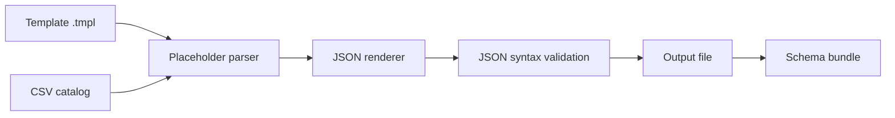

# Build

Status: IMPLEMENTED / OPEN
Scope: Normative for build behavior
Last updated: 2026-11-24

## Purpose

This document defines how to build, test, and generate schema artifacts with
Bazel. It records the commands that are verified in the repository and the known
gaps that must be closed before release.

## Prerequisites

| Tool | Requirement | Evidence |
|---|---|---|
| Bazelisk | Required; reads `.bazelversion`. | `.bazelversion` pins 9.3.3. |
| Git | Required. | Repository tooling. |
| Python for Bazel | Provided by the hermetic toolchain. | `MODULE.bazel` uses Python 3.14. |
| Python for local scripts | Optional; used for audit and validation scripts. | Local environment. |
| Typst CLI | Optional for build; required for compiler tests and PDF. | `typst --version`. |
| Node.js | Required only for TypeScript tooling and consumer tests. | `package.json` requires >=22. |

No separate Python runtime is required for Bazel targets. A local Python runtime
is useful for running the generator outside Bazel and for repository scripts.

## Commands

Build all configured targets:

```shell
bazel build //...
```

Run all tests:

```shell
bazel test //...
```

Build the schema bundle:

```shell
bazel build //specs/schemas:schema_bundle
```

Run the generator with absolute paths:

```shell
bazel run //tools/codegen:typcast_codegen -- --input "$PWD/specs/schemas/templates/api/types/paper.schema.json.tmpl" --output "$PWD/out/paper.schema.json"
```

Run the built binary from the repository root:

```shell
bazel-bin/tools/codegen/typcast_codegen.exe --input specs\schemas\templates\api\types\paper.schema.json.tmpl --output out\paper.schema.json
```

The `bazel run` example in the original README used workspace-relative paths and
failed on Windows. Use absolute paths or the built binary from the repository
root.

## Verified baseline

| Check | Result |
|---|---|
| `bazel build //...` | Pass, 12 targets. |
| `bazel test //...` | Pass, 1 test target, 7 unittest cases. |
| `bazel build //specs/schemas:schema_bundle` | Pass, 5 schema files. |
| `bazel query "kind(rule, //...)"` | 12 rules; 1 test target. |
| `--test_filter` on the unittest target | Ignored; all 7 cases run. |

The schema bundle contains:

```text
bazel-bin/specs/schemas/
  validator.schema.json
  api/types/alignment.schema.json
  api/types/length.schema.json
  api/types/paper.schema.json
  definitions/bound.schema.json
```

## Current targets

`bazel query "kind(rule, //...)"` reports 12 rules. All of them:

| Target | Kind | Purpose |
|---|---|---|
| `//tools/codegen:typcast_codegen` | `py_binary` | Generator CLI. |
| `//tools/codegen:typcast_codegen_lib` | `py_library` | Generator library. |
| `//tools/codegen/tests:unit_tests` | `py_test` | Seven generator tests. |
| `//specs/schemas:validator_schema` | `typcast_schema_copy` | Stage the root schema. |
| `//specs/schemas:alignment_schema` | `typcast_json_schema` | Generate alignment schema. |
| `//specs/schemas:length_schema` | `typcast_json_schema` | Generate length schema. |
| `//specs/schemas:paper_schema` | `typcast_json_schema` | Generate paper schema. |
| `//specs/schemas:schema_bundle` | `filegroup` | Collect the schema bundle. |
| `//specs/schemas/definitions:bound_schema` | `typcast_schema_copy` | Stage the bound schema. |
| `//packages/python:typcast` | `py_library` | Python SDK placeholder. |
| `//packages/typescript:typcast` | `ts_project` | TypeScript SDK placeholder. |
| `//packages/typescript:typcast_types` | `filegroup` | TypeScript declaration outputs. |

Two convenience filegroups, `//specs/schemas/templates/api/types:schema_templates`
and `//specs/catalogs/enums:enum_catalogs`, were removed because no target
consumed them and the individual files are already exported. `schema_bundle` is
kept as the published entry point for the schema archive.
`//packages/typescript:typcast_types` is generated by `aspect_rules_ts` and is
not a hand-written target.

## Code generation pipeline



The generator:

- Resolves placeholder paths relative to the template file.
- Reads UTF-8 CSV with an optional BOM.
- Requires a header row.
- Rejects empty values in the selected column.
- Skips fully blank rows.
- Creates output parent directories.
- Re-serializes JSON with two-space indentation.
- Validates JSON syntax only.

The generator does not validate JSON Schema semantics or resolve `$ref` values.
Those checks belong to the schema test layer.

## Adding a schema

1. Add the `.tmpl` under `specs/schemas/templates/`.
2. Export it in the template `BUILD.bazel`.
3. Add a `typcast_json_schema` rule in `specs/schemas/BUILD.bazel`.
4. List every CSV used by the template in the rule's `catalogs` attribute.
5. Set the `output` path to match the relative `$ref` paths used by consumers.
6. Add the target to `schema_bundle`.
7. Add a schema validation test.
8. Rebuild and inspect the output.

## Generated artifacts

- Generated files are written under `bazel-bin/`.
- Source files remain under `specs/schemas/`.
- Bazel does not copy ordinary source files into `bazel-bin` unless an action
  declares an output.
- Static schemas are staged with `typcast_schema_copy`, which uses a symlink
  action.
- Generated artifacts MUST NOT be committed to the development branch.
- The published schema bundle is the only exception. The release commit
  publishes it under `specs/schemas/` so that the versioned raw URLs resolve.
- Do not edit `bazel-bin/` files by hand.

## Reproducibility

| Control | Status |
|---|---|
| Bazel version pinned in `.bazelversion` | Implemented. |
| `MODULE.bazel.lock` committed | Implemented. |
| Hermetic Python 3.14 toolchain | Implemented. |
| TypeScript version from root `package.json` | Implemented. |
| No generated files in git | Implemented. |
| CI disk cache keyed by version and lockfile | Confirmed. |
| Remote cache or remote execution | Deferred. |

## Platform notes

### Windows

- `.bazelrc` enables `startup --windows_enable_symlinks`.
- The flag must be made conditional or verified on Linux before CI.
- `core.autocrlf=true` is configured and `.gitattributes` pins LF for text
  files. Git converts text files to CRLF on checkout without that file, so
  LF-only documents are only stable in the working tree until `.gitattributes`
  pins them.
- Documentation and the root `README.md` are stored with LF line endings.
- `bazel run` with workspace-relative input paths fails; use absolute paths.

### Linux

- The Windows startup flag must not break Bazel startup.
- CI must run the same `bazel build //...` and `bazel test //...` commands.
- Case-sensitive paths must be used consistently.

## Future targets

The MVP must add these targets. The names are final:

| Target | Purpose |
|---|---|
| `//packages/python:wheel` | Python wheel. |
| `//packages/python:sdist` | Python source distribution. |
| `//packages/typescript:npm_package` | npm tarball. |
| `//specs/schemas:archive` | Schema archive for release. |
| `//specs/schemas:schema_tests` | Validates the built bundle and every `$ref`. |
| `//tests/contract:parity_tests` | Cross-language parity tests. |
| `//tests/integration:compiler_tests` | Compiler integration tests. |

`//specs/schemas:schema_tests` validates the generated bundle as the
authoritative artifact set. Source-tree `$ref` resolution is not a release
requirement; see `specifications/schema.md` and ADR-0023.

`//specs/schemas:archive` packages the same bundle for the GitHub Release
asset, and the release commit publishes the bundle under `specs/schemas/` so
that the versioned raw URLs resolve. See `development/release.md` and ADR-0022.

The artifact requirements for the packaging targets are defined in
`development/release.md`.

## Requirements

| ID | Requirement | Status | Verification |
|---|---|---|---|
| BUILD-001 | Bazel MUST remain the primary build system. | CONFIRMED | `bazel build //...`. |
| BUILD-002 | Bazelisk MUST use the version in `.bazelversion`. | CONFIRMED | Version check. |
| BUILD-003 | `MODULE.bazel.lock` MUST be committed. | CONFIRMED | Git check. |
| BUILD-004 | The Bazel Python toolchain MUST be hermetic. | CONFIRMED | `MODULE.bazel`. |
| BUILD-005 | New Python package directories MUST contain `__init__.py`. | CONFIRMED | Build. |
| BUILD-006 | `bazel build //...` MUST pass before merge. | CONFIRMED | CI. |
| BUILD-007 | `bazel test //...` MUST pass before merge. | CONFIRMED | CI. |
| BUILD-008 | Every CSV used by a template MUST be declared in `catalogs`. | CONFIRMED | Sandbox build. |
| BUILD-009 | Generated artifacts MUST NOT be committed to the development branch; the published schema bundle MUST be committed only in the tagged release commit (`REL-030`). | CONFIRMED | Review. |
| BUILD-010 | The generator MUST support absolute input and output paths. | IMPLEMENTED | Manual run. |
| BUILD-011 | The build MUST NOT rely on `--test_filter` for this `py_test`. | CONFIRMED | Verified behavior. |
| BUILD-012 | Linux CI MUST prove that Bazel starts with the current `.bazelrc`; if the Windows symlink startup flag is rejected, it moves to a Windows-only rc file. | CONFIRMED | Linux CI startup check. |
| BUILD-013 | TypeScript compiler version MUST come from the root manifest. | CONFIRMED | `MODULE.bazel`. |
| BUILD-014 | The packaging targets MUST be `//packages/python:wheel`, `//packages/python:sdist`, `//packages/typescript:npm_package`, and `//specs/schemas:archive`. | CONFIRMED | Release review. |
| BUILD-015 | Schema validation MUST run in `//specs/schemas:schema_tests` against the built bundle. | CONFIRMED | Test target. |
| BUILD-016 | Hand-written filegroups with no consumer MUST be removed; `schema_bundle` MUST be kept as the published schema entry point. | IMPLEMENTED | `bazel query "rdeps(//..., //specs/schemas:schema_bundle)"`; unused aggregates removed. |
| BUILD-017 | Documentation checks MUST NOT require SDK installation. | CONFIRMED | Docs CI. |
| BUILD-018 | CI MUST build the repository from a clean checkout to prove reproducibility. | CONFIRMED | Clean-checkout CI job. |
| BUILD-019 | CI MUST cache Bazel outputs per operating system, keyed by the Bazel version, `MODULE.bazel.lock`, and build files. | CONFIRMED | CI review. |
| BUILD-020 | Build logs MUST NOT contain secrets or document content. | CONFIRMED | Security review. |

## Open questions

- Should the schema archive be a `.tar.gz` or a `.zip`?
- Should the repository use a remote cache in a later phase?
- Should `bazel test //...` run compiler tests when Typst is available?

## Related documents

- [Repository architecture](../architecture/repository.md)
- [Schema contract](../specifications/schema.md)
- [Testing](testing.md)
- [CI/CD](ci-cd.md)
- [Release](release.md)
- [ADR-0018](../decisions/ADR-0018-toolchain-and-ci-matrix.md)
- [ADR-0022](../decisions/ADR-0022-release-artifacts-schema-distribution-and-response-policy.md)
- [ADR-0023](../decisions/ADR-0023-schema-bundle-validation.md)
