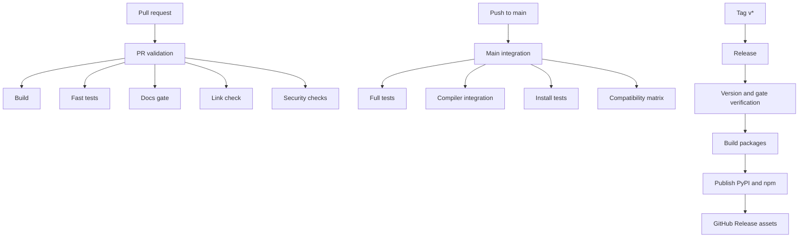

# CI/CD

Status: PROPOSED
Scope: Normative
Last updated: 2026-11-24

## Purpose

This document defines the CI/CD workflows for pull requests, main integration,
and release. The MVP uses three separate workflows so that publishing
credentials are never available to pull request code.

The three workflow files exist. They build, test, and check the repository, and
the release lane verifies the release. The publishing jobs are not part of them
yet, because the packaging targets do not exist.

## Workflow overview

| Workflow | Trigger | Purpose | Permissions |
|---|---|---|---|
| PR validation | `pull_request` | Build, fast tests, docs, security checks. | `contents: read` |
| Main integration | `push` to `main` | Full tests, compiler integration, install tests, matrix. | `contents: read` |
| Release | Tag `v*` | Verify, package, publish, attach release assets. | `contents: write`, `id-token: write` |



## Implemented workflows

| File | Trigger | Jobs |
|---|---|---|
| `.github/workflows/pr.yml` | `pull_request` on `main`, manual | `Build`, `Test`, `Clean build`, `Documentation gate`, `Link check` |
| `.github/workflows/main.yml` | `push` to `main`, manual | The same five jobs |
| `.github/workflows/release.yml` | `push` of a `v*` tag, manual | `Verify`, `Published schema bundle` |

Every job installs Bazelisk and reads the Bazel version from `.bazelversion`.
The `Build` and `Test` jobs run on `windows-latest` and `ubuntu-latest`. The
`Clean build` job runs on Linux with every cache disabled, so it proves that
the build does not depend on a warm cache or on an untracked file. The
`Documentation gate` job runs `bazel test //scripts:docs_checks` on its own,
so that a reviewer sees the documentation result as a check of its own. The
`Link check` job runs `bazel run //scripts:check_links`; it needs the network
and reports warnings only, so it never blocks a merge.

The release lane checks the version consistency of the manifests and the tag,
it builds and tests the tagged commit, it compares the published schema bundle
of the tagged commit with the build, and it fetches every published schema from
its versioned raw URL. It does not publish; the publishing jobs arrive with
the packaging targets.

The actions are pinned to commit SHAs, and the repository gate rejects a
workflow that uses a tag or a branch.

## PR validation

Triggers:

- `pull_request` to `main`.
- No secrets.
- No publishing.

Jobs:

1. Checkout with full history only if needed for version checks.
2. Set up Bazelisk and cache.
3. `bazel build //...`.
4. `bazel test //...` for the fast lane.
5. Schema validation: `bazel test //specs/schemas:schema_tests`.
6. Contract and golden tests.
7. Cross-language parity tests.
8. Repository checks: `bazel test //scripts:docs_checks`.
9. Dependency and secret scanning where available.

Steps 5 to 7 have no target yet, and step 9 is a repository setting. The
workflow runs the steps that have a target today.

Permissions:

```yaml
permissions:
  contents: read
```

The workflow must not use `pull_request_target` for code execution.

## Main integration

Triggers:

- `push` to `main`.
- Manual dispatch for diagnostics.

Jobs:

1. Full test lane on Windows and Linux.
2. Compiler integration with the supported Typst version.
3. Install and consumer tests from wheel and npm tarball.
4. Compatibility matrix for Python and Node.
5. Benchmark job on the main lane.
6. Documentation gate for all documents.
7. Cache warm for the next run.

Permissions:

```yaml
permissions:
  contents: read
```

Main integration does not publish.

## Release

Triggers:

- Tag `v*`.
- Manual approval through a protected environment.

Preconditions:

- Tag matches the package versions.
- Tag matches the schema version.
- Changelog contains the release.
- All tests pass.
- Documentation gate passes.
- Security checks pass.
- Artifacts are built from the tagged commit.
- The tagged commit contains the complete published schema bundle under
  `specs/schemas/`.

Jobs:

1. Verify version consistency across `MODULE.bazel`, the root `package.json`,
   `pyproject.toml`, `packages/typescript/package.json`, and the tag.
2. Build wheel, sdist, npm tarball, schema archive, checksums, and SBOM.
3. Compare the published schema bundle in the tagged commit with the built
   bundle.
4. Run install tests against the built artifacts.
5. Publish Python to PyPI.
6. Publish npm package.
7. Create or update the GitHub Release.
8. Attach artifacts and checksums.
9. Fetch every published schema from its versioned raw URL and compare it with
   the release bundle.
10. Record the Typst version used for verification.

Permissions:

```yaml
permissions:
  contents: write
  id-token: write
```

Publishing credentials:

- Prefer PyPI trusted publishing with OIDC.
- Prefer npm trusted publishing where available.
- If a token is required, store it in an environment secret, never in the
  repository.
- The release environment requires manual approval.
- The release job uses a concurrency lock to prevent duplicate publishes.

## Caching

Bazel cache:

- Separate cache per operating system.
- Key includes the Bazel version, `MODULE.bazel.lock`, and build files.
- Restore keys are scoped to the OS and Bazel version.
- Cache is not shared between pull requests from forks and trusted branches.
- Cache contents are never treated as trusted build outputs.

The workflows use `bazel-contrib/setup-bazel`, which caches the Bazelisk
downloads, the repository cache, the external repositories, and the action
outputs. The cache key holds the operating system, the architecture, the Bazel
version, the lockfile, and the build files. The pull request lane restores the
cache but does not save it, so a fork pull request cannot fill the cache of the
trusted branches. The main lane saves it.

Other caches:

- Python package cache for install tests.
- npm cache for consumer tests.
- No cache for compiler output.

## Matrix

| Dimension | PR fast lane | Main full lane | Release |
|---|---|---|---|
| OS | Windows, Linux | Windows, Linux | Windows, Linux |
| Python | 3.11, 3.14 | 3.11, 3.12, 3.13, 3.14 | 3.11 to 3.14 |
| Node | 22 | 22, 24 | 22, 24 |
| Typst | Optional | 0.15.1 | 0.15.1 |
| Compiler tests | If available | Required | Required |
| Install tests | No | Required | Required |
| Clean-checkout build | No | Required | Required |

The matrix is `CONFIRMED`. The pull request lane keeps the minimum and newest
Python versions to control runtime. The full lane covers every supported
Python and Node version. The release lane repeats the full lane against the
built artifacts.

The workflows run the operating system dimension today. The Python, Node.js,
and Typst dimensions become active when the SDK, the compiler adapter, and the
install tests exist, because the current tests run with the hermetic toolchain
of the repository and need no runtime of the runner.

The clean-checkout build job checks out the repository without any Bazel cache
and runs `bazel build //...` to prove the build does not depend on a warm
cache or on untracked files.

## Artifacts

| Artifact | Retention | Purpose |
|---|---|---|
| Test reports | 14 days | Debugging failed runs. |
| Benchmark JSON | 90 days | Trend comparison. |
| Wheel and sdist | 14 days in CI, permanent in release | Install tests and release. |
| npm tarball | 14 days in CI, permanent in release | Install tests and release. |
| Schema archive | 14 days in CI, permanent in release | Contract distribution. |
| SBOM | Permanent in release | Supply-chain record. |
| Checksums | Permanent in release | Verification. |

## Concurrency

- PR workflows cancel superseded runs for the same pull request.
- Main workflows do not cancel an in-progress release.
- Release workflows use a single concurrency group per tag.
- Release workflows do not run in parallel for the same version.

## Security

- PR workflows have read-only permissions.
- Release workflows use least privilege.
- Secrets are not printed.
- Logs do not include document content or asset contents.
- Fork pull requests do not receive secrets.
- Third-party actions are pinned to commit SHAs.
- Dependency review runs on pull requests where available.
- Secret scanning and push protection are enabled on the repository.

## Current state

| Item | Current |
|---|---|
| Workflows | Three: `.github/workflows/pr.yml`, `main.yml`, and `release.yml`. |
| Pull request checks | `Build`, `Test`, `Clean build`, `Documentation gate`, and `Link check`. The first four run on Windows and Linux; the link check runs on Linux. |
| Cache | Bazel cache per operating system, keyed by version, lockfile, and build files. |
| Matrix | The operating system dimension. The runtime dimensions wait for the SDK. |
| Action pinning | Every action is pinned to a commit SHA. The repository gate enforces it. |
| Release lane | Verifies the version, the tagged build, the published bundle, the archive of the published bundle, and the raw URLs. It does not publish. |
| Release environment | None. |
| Trusted publishing | None. |
| Required checks | The six checks of the pull request lane. The branch protection of `main` requires them. The link check runs as well, but it reports warnings only and is not required. |
| Published schema bundle | None; the preparation command exists, but no release commit exists yet. |

The first pull request run of the workflows passed on 2026-11-24: the build,
the test lane, the clean checkout build, and the documentation gate passed on
`windows-latest` and `ubuntu-latest`. The Linux run also proved that Bazel
starts with the current `.bazelrc`.

## Requirements

| ID | Requirement | Status | Verification |
|---|---|---|---|
| CI-001 | The repository MUST have PR validation, main integration, and release workflows. | IMPLEMENTED | `.github/workflows/pr.yml`, `.github/workflows/main.yml`, and `.github/workflows/release.yml`. |
| CI-002 | PR workflows MUST have read-only permissions. | IMPLEMENTED | `permissions: contents: read` in `pr.yml` and `main.yml`; the repository gate rejects write access in a pull request workflow. |
| CI-003 | PR workflows MUST NOT access publishing secrets. | IMPLEMENTED | No workflow reads a secret; the repository gate rejects a secret in a pull request workflow. |
| CI-004 | Main integration MUST run on every push to `main`. | IMPLEMENTED | `.github/workflows/main.yml`. |
| CI-005 | Release MUST run only on `v*` tags with manual approval. | CONFIRMED | The tag trigger is implemented. The protected environment is a repository setting and is not configured. |
| CI-006 | Release MUST verify version consistency before publishing. | CONFIRMED | `//scripts:check_version` and the release lane. The publishing step does not exist yet. |
| CI-007 | Release MUST build artifacts from the tagged commit. | CONFIRMED | Release check. |
| CI-008 | Release MUST run install tests before publishing. | CONFIRMED | Release check. |
| CI-009 | Release MUST use OIDC or environment secrets, never repository secrets. | CONFIRMED | Workflow review. |
| CI-010 | Bazel cache MUST be separated by OS. | IMPLEMENTED | The cache key of the workflows holds the operating system and the architecture. |
| CI-011 | Cache keys MUST include Bazel version and lockfile. | IMPLEMENTED | The cache key hashes `.bazelversion`, `MODULE.bazel.lock`, and the build files. |
| CI-012 | CI MUST run on Windows and Linux. | IMPLEMENTED | The build and test lanes run on `windows-latest` and `ubuntu-latest`; the first run passed on both. |
| CI-013 | Compiler integration MUST run on main and release. | CONFIRMED | Matrix review. |
| CI-014 | Documentation gate MUST run on PRs and main. | IMPLEMENTED | The `Documentation gate` job of `pr.yml` and `main.yml`. |
| CI-015 | Security checks MUST run on PRs where available. | CONFIRMED | Workflow review. |
| CI-016 | Release MUST attach checksums and SBOM. | CONFIRMED | Release check. |
| CI-017 | Release MUST use a concurrency lock. | IMPLEMENTED | The release workflow uses one concurrency group per tag and does not cancel a run. |
| CI-018 | CI artifacts MUST have documented retention. | CONFIRMED | This document. |
| CI-019 | Third-party actions MUST be pinned. | IMPLEMENTED | Every action is pinned to a commit SHA; the repository gate rejects a tag or a branch. |
| CI-020 | CI MUST NOT publish from pull requests. | IMPLEMENTED | No workflow publishes; the pull request workflow has read-only permissions. |
| CI-021 | CI MUST report test results and logs for failures. | IMPLEMENTED | The Bazel test lane prints the output of every failing test, through `test --test_output=errors` in `.bazelrc`. |
| CI-022 | CI MUST NOT print secrets or document content. | CONFIRMED | Review. |
| CI-023 | The release environment MUST require manual approval. | CONFIRMED | Environment settings. |
| CI-024 | The CI matrix MUST cover Windows and Linux, Python 3.11 to 3.14, Node.js 22 and 24, and Typst 0.15.1, with the pull request lane limited to the minimum and newest Python versions. | CONFIRMED | Matrix review. |
| CI-025 | The workflow files MUST be added in a separate implementation change. | IMPLEMENTED | The three workflow files are in their own commits. |
| CI-026 | The release lane MUST verify that the tagged commit contains the complete published schema bundle and that every published schema resolves at its versioned raw URL. | IMPLEMENTED | The release lane runs `publish_schemas check`, `compare-archives`, and `publish_schemas verify`. The rehearsal `//scripts/tests:release_flow_tests` runs the path against the built bundle. |
| CI-027 | The pull request and main lanes MUST run the Bazel build and the test lane on Windows and Linux, MUST run the documentation gate and the external link check, and the release lane MUST verify the version consistency, the tagged build, the published bundle, the archive of the published bundle, and the versioned raw URLs. | IMPLEMENTED | The three workflow files; the first pull request run passed on 2026-11-24. |
| CI-028 | The repository gate MUST reject an action that is not pinned to a commit SHA, a workflow without a permissions block, a pull request workflow with write access, a pull request workflow that reads a secret, and a workflow that uses `pull_request_target`. | IMPLEMENTED | `scripts/validate_docs.py`; `//scripts:docs_checks` checks three workflow files. |

## Open questions

- Which release environment protects the publishing jobs, and who approves it?
- Is a self-hosted runner needed for stable benchmarks?
- Is npm trusted publishing available for the chosen account?
- Which dependency review and secret scanning settings are enabled on the
  repository?

## Related documents

- [Testing](testing.md)
- [Benchmarking](benchmarking.md)
- [Release](release.md)
- [Security](security.md)
- [Documentation](documentation.md)
- [ADR-0009](../decisions/ADR-0009-three-workflows-and-disk-cache.md)
- [ADR-0018](../decisions/ADR-0018-toolchain-and-ci-matrix.md)
- [ADR-0022](../decisions/ADR-0022-release-artifacts-schema-distribution-and-response-policy.md)
