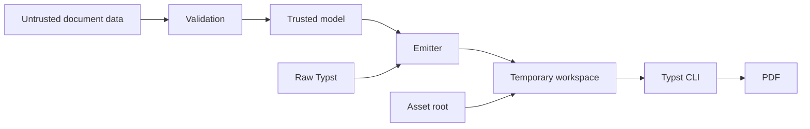

# Security

Status: CONFIRMED / PROPOSED
Scope: Normative
Last updated: 2026-11-24

## Purpose

This document defines the MVP security baseline, threat model, and supply-chain
controls. Typcast processes documents, reads local assets, and invokes a local
compiler. It does not run a hosted service and does not bundle the compiler.

## Security principles

1. Treat document input as untrusted unless the application says otherwise.
2. Treat raw Typst as trusted code, not as data.
3. Reject path traversal and absolute paths before reading files.
4. Never invoke a shell with user-controlled content.
5. Use least privilege for CI and release.
6. Publish verifiable artifacts with checksums and an SBOM.
7. Keep the dependency surface small.
8. Do not log document content, asset content, or secrets by default.

## Threat model

| Threat | Impact | Control |
|---|---|---|
| Malformed JSON | Crash or unexpected behavior | Schema validation and typed errors. |
| Unknown fields | Silent contract drift | Closed objects and negative tests. |
| Path traversal | Read files outside the asset root | Path normalization and real-path checks. |
| Absolute path in document | Read arbitrary files | Reject absolute and UNC paths. |
| Symlink escape | Read outside the root | Resolve symlinks and check the target. |
| Raw Typst abuse | Read workspace files or run expensive layout | Treat raw as trusted; external sandbox for untrusted input. |
| Compiler command injection | Arbitrary command execution | Argument arrays, no shell. |
| Compiler timeout | Resource exhaustion | Configurable timeout and process termination. |
| Huge raw or asset input | Memory or disk exhaustion | Size limits and streaming where practical. |
| Malicious Typst binary | Arbitrary code execution | User-installed compiler; version check; trust boundary documented. |
| Dependency compromise | Supply-chain compromise | Lockfiles, review, scanning, checksums. |
| Release credential leak | Unauthorized publish | OIDC, protected environment, least privilege. |
| Artifact tampering | Users install altered packages | Checksums and registry integrity; signing deferred. |
| Log leakage | Sensitive document content exposed | No content logging by default. |
| Temp file leakage | Document content left on disk | Clean workspace after compilation. |

## Trust boundaries

Raw Typst crosses the boundary from data to code. Typcast does not sandbox it.
Applications that accept raw Typst from untrusted users must run the compiler in
an operating-system sandbox or a separate worker with restricted filesystem and
network access.

## License

- The repository and packages use Apache-2.0.
- `LICENSE` is present at the repository root.
- `NOTICE` is added only when third-party content requires it.
- Dependency licenses must be compatible with Apache-2.0.
- A license inventory is maintained for direct dependencies.
- License changes require an explicit decision and a major version.

## Vulnerability reporting

`SECURITY.md` defines the private reporting channel, the supported versions,
the response targets, the disclosure process, and the request not to open
public issues for vulnerabilities.

The response targets are:

| Stage | Target |
|---|---|
| Acknowledgement of a valid report | 3 business days |
| Initial triage and impact assessment | 7 business days |
| Fix or mitigation plan for critical and high severity issues | 14 calendar days |
| Fix release for critical and high severity issues | 30 calendar days |
| Coordinated disclosure window after a fix ships | 90 days |

Severity is assessed with CVSS 3.1 as a starting point. Reports that are not
vulnerabilities are answered privately and tracked until the reporter agrees
with the classification.

## Secrets

- No secrets in the repository.
- Secret scanning and push protection are enabled.
- `.gitignore` includes `.env` patterns.
- CI does not print environment variables.
- Release credentials are environment secrets or OIDC tokens.
- Pull requests from forks do not receive secrets.
- Logs do not include tokens, document content, or asset content.

## Dependencies

- Direct dependencies are reviewed before addition.
- Bazel module changes require review.
- Python and npm lockfiles are committed when the ecosystem provides them.
- Dependabot or Renovate is enabled for supported ecosystems.
- Bazel dependencies are reviewed manually.
- License inventory covers direct dependencies.
- A dependency with an incompatible license is rejected.
- A dependency with a known critical vulnerability blocks release until
  resolved or explicitly accepted.

## Compiler security

- The compiler is user-installed and not bundled.
- The adapter checks the version.
- The adapter runs without a shell.
- The adapter sets `--root` to the temporary workspace.
- The adapter copies only referenced assets.
- The adapter does not fetch packages.
- The adapter applies a timeout.
- The adapter cleans the workspace.
- The adapter does not claim to sandbox raw Typst.
- The compiler runs with the user's permissions.

## Artifact security

- Every release artifact has a SHA-256 checksum.
- An SBOM is attached to the release.
- The release environment is protected and requires approval.
- Release jobs use least privilege.
- Artifacts are built from the tagged commit.
- Install tests run against the built artifacts.
- Artifact signing and SLSA provenance are Post-MVP.
- Registry-native attestations, such as npm provenance, are optional.
- Registry integrity is relied on for transport and storage.

## Data handling

- The SDK does not send documents over the network.
- The SDK does not collect telemetry.
- The SDK does not log document content by default.
- The SDK does not write files except when the caller requests an output path or
  a temporary workspace is needed for compilation.
- Temporary workspaces are removed after use.
- Error details may include file paths; callers should treat diagnostics as
  sensitive when paths reveal internal structure.

## Current gaps

| Gap | Impact | Status |
|---|---|---|
| No `LICENSE` | Cannot publish legally. | CLOSED. `LICENSE` present. |
| No `SECURITY.md` | No disclosure channel. | CLOSED. `SECURITY.md` present. |
| No secret scanning configuration | Leaks are not detected. | OPEN |
| No dependency update bot | Vulnerabilities age. | OPEN |
| No SBOM | Release lacks supply-chain record. | OPEN |
| No checksums | Artifacts are not independently verifiable. | OPEN |
| No release environment | Publishing is not protected. | OPEN |
| `.gitignore` lacks `.env` | Accidental secret commit risk. | OPEN |
| Raw Typst not sandboxed | Untrusted raw input is dangerous. | CONFIRMED limitation |

## Requirements

| ID | Requirement | Status | Verification |
|---|---|---|---|
| SEC-001 | The repository and packages MUST use Apache-2.0. | CONFIRMED | License check. |
| SEC-002 | `LICENSE` MUST exist before publication. | IMPLEMENTED | `LICENSE` present at the repository root. |
| SEC-003 | `SECURITY.md` MUST define private disclosure. | IMPLEMENTED | `SECURITY.md` present at the repository root. |
| SEC-004 | Secret scanning and push protection MUST be enabled. | CONFIRMED | Repository settings. |
| SEC-005 | `.gitignore` MUST include `.env` patterns. | CONFIRMED | Review. |
| SEC-006 | Dependencies MUST be reviewed before addition. | CONFIRMED | Process review. |
| SEC-007 | Dependency updates MUST be automated where supported. | CONFIRMED | Bot configuration. |
| SEC-008 | A license inventory MUST exist for direct dependencies. | CONFIRMED | Release check. |
| SEC-009 | A SBOM MUST be attached to each release. | CONFIRMED | Release check. |
| SEC-010 | SHA-256 checksums MUST be published for artifacts. | CONFIRMED | Release check. |
| SEC-011 | Release workflows MUST use least privilege. | CONFIRMED | Workflow review. |
| SEC-012 | Release credentials MUST NOT be stored in the repository. | CONFIRMED | Workflow review. |
| SEC-013 | The compiler MUST be invoked without a shell. | CONFIRMED | Code review. |
| SEC-014 | The compiler MUST run with `--root` set to the workspace. | CONFIRMED | Command review. |
| SEC-015 | Path traversal MUST be rejected before file reads. | CONFIRMED | Negative test. |
| SEC-016 | Absolute and UNC paths MUST be rejected. | CONFIRMED | Negative test. |
| SEC-017 | Symlinks MUST be checked after resolution. | CONFIRMED | Symlink test. |
| SEC-018 | The SDK MUST NOT collect telemetry. | CONFIRMED | Code review. |
| SEC-019 | The SDK MUST NOT log document content by default. | CONFIRMED | Code review. |
| SEC-020 | Temporary workspaces MUST be cleaned after compilation. | CONFIRMED | Workspace test. |
| SEC-021 | Raw Typst MUST be documented as trusted input. | CONFIRMED | Documentation review. |
| SEC-022 | A dependency with a critical vulnerability MUST block release. | CONFIRMED | Release review. |
| SEC-023 | Artifact signing and SLSA provenance MUST be Post-MVP. | DEFERRED | Scope review. |
| SEC-024 | The vulnerability response targets MUST be the ones defined in `SECURITY.md` and in this document. | CONFIRMED | Policy review. |
| SEC-025 | The SBOM MUST be generated in CycloneDX 1.6 JSON and attached to each release. | CONFIRMED | Release check. |

## Open questions

- Which tool generates the CycloneDX SBOM?
- Is an external sandbox recommended for all compiler runs or only untrusted
  raw input?
- Should the SDK provide a `--no-network` compiler option if Typst supports one?
- Should the private reporting channel also include a monitored email address?

## Related documents

- [Compiler adapter](../specifications/compiler.md)
- [Assets and modules](../specifications/assets.md)
- [CI/CD](ci-cd.md)
- [Release](release.md)
- [ADR-0011](../decisions/ADR-0011-apache-license.md)
- [ADR-0022](../decisions/ADR-0022-release-artifacts-schema-distribution-and-response-policy.md)
