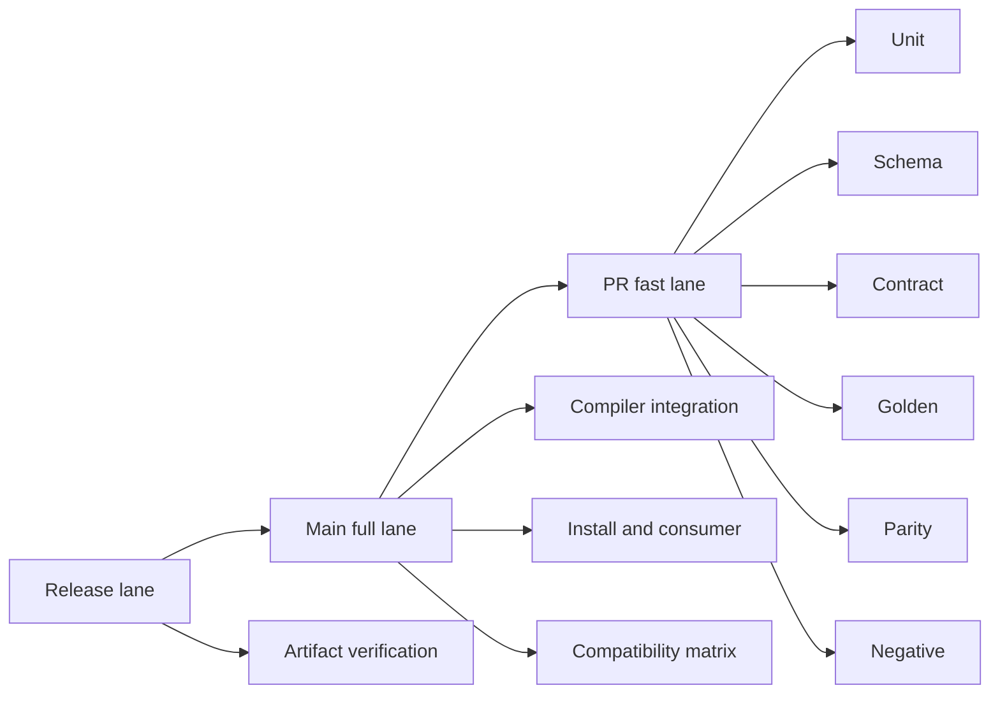

# Testing

Status: PROPOSED
Scope: Normative
Last updated: 2026-11-27

## Purpose

This document defines the test layers, shared fixtures, parity rules, and gates
for the MVP. The goal is to prove the contract, not only the implementation:
schema validity, model round-trips, deterministic `.typ`, cross-language parity,
compiler integration, and package installation.

## Current state

| Area | Current state |
|---|---|
| Test targets | Twenty hand-written test targets: `//tools/codegen/tests:unit_tests`, `//tools/enumgen/tests:unit_tests`, `//tools/publish/tests:publish_tests`, `//scripts/tests:version_tests`, `//scripts/tests:release_tests`, `//scripts/tests:release_flow_tests`, `//scripts/tests:repository_tests`, `//scripts/tests:docs_tests`, `//scripts/tests:link_tests`, `//scripts:docs_checks`, `//specs/schemas:schema_tests`, `//specs/schemas:release_tag_tests`, `//packages/python/tests:model_tests`, `//packages/python/tests:validation_tests`, `//packages/typescript:model_test_run`, `//packages/typescript:validation_test_run`, `//tests/contract:contract_py`, `//tests/contract:contract_ts_test`, `//tests/contract:validation_py`, and `//tests/contract:validation_ts_test`. The TypeScript toolchain adds four generated type-check targets. |
| Test cases | Sixteen generator cases, twenty enum expansion cases, 45 publisher cases, 15 version cases, 20 release preparation cases, 6 release rehearsal cases, 47 repository structure cases, 4 release tag cases, 32 documentation gate cases, 4 link check cases, one documentation check, one schema bundle check, 131 document model cases, 12 contract fixture cases, 28 validation cases, and 6 validation contract fixture cases. |
| Schema tests | `//specs/schemas:schema_tests` validates the built bundle. Meta-schema and instance validation are missing. |
| Release tag tests | `//specs/schemas:release_tag_tests` covers the release tag pattern of the contract, so that the contract and the publisher agree on what a release tag is. |
| Publisher tests | `//tools/publish/tests:publish_tests` covers the publisher, the published identity of the built bundle, the resolution of the versioned raw URLs, and the deterministic archive. |
| Version tests | `//scripts/tests:version_tests` covers the release version check, including the contract version of every schema source. |
| Release preparation tests | `//scripts/tests:release_tests` covers the release preparation, the publication, the verification, and the cleanup. |
| Release rehearsal | `//scripts/tests:release_flow_tests` rehearses the release commit with the manifests, the schema sources, and the bundle of the build, so that the path of the release lane runs in every test lane. |
| Repository structure tests | `//scripts/tests:repository_tests` covers the rules of the repository structure checks against a synthetic repository, so that a rule cannot pass because of the state of the checkout. |
| Gate tests | `//scripts/tests:docs_tests` and `//scripts/tests:link_tests` cover the rules of the repository gate and of the external link check, including the encoding and the text hygiene rules. |
| Model tests | `//packages/python/tests:model_tests` and `//packages/typescript:model_test_run` cover the immutability, the constructor checks, the canonical JSON form, the reader, the round trip of the document model, and the paper catalog that the model of a page checks its value against. |
| Validation tests | `//packages/python/tests:validation_tests` and `//packages/typescript:validation_test_run` cover the semantic rules, the configuration of the raw size limit, and the order of the diagnostics. |
| Contract tests | `//tests/contract:contract_py` and `//tests/contract:contract_ts_test` read the same shared fixtures and the same manifest, so a drift in either SDK fails one of the two targets. |
| Validation contract tests | `//tests/contract:validation_py` and `//tests/contract:validation_ts_test` read the same validation fixtures and the same manifest, so a drift in the diagnostics of either SDK fails one of the two targets. |
| Golden `.typ` tests | None. |
| Parity tests | The serialization parity of the document IR and the diagnostic parity of the validation engine are covered by the contract runners. The `.typ` parity is not implemented. |
| Compiler integration | None. |
| Install tests | None. |
| CI | The pull request and main lanes run the build, the test lane, the clean checkout build, and the documentation gate on Windows and Linux. |

The current `--test_filter` is ignored by the `py_test`; all sixteen cases run. Do
not rely on filtering for local iteration.

## Schema bundle test

`//specs/schemas:schema_tests` runs against the bundle that
`//specs/schemas:schema_bundle` produces, because the bundle is the
authoritative artifact set.

```shell
bazel test //specs/schemas:schema_tests
```

| Check | Rule |
|---|---|
| Encoding | UTF-8 JSON without a byte order mark. |
| Dialect | `$schema` is draft 2020-12. |
| Identity | An absolute, unique `$id` that matches the published versioned raw URL. |
| References | Every relative `$ref` resolves inside the bundle. |
| Closed objects | `additionalProperties: false` or `unevaluatedProperties: false`. |
| Required fields | A `required` list whose entries exist in `properties`. |
| Discriminators | A `type` discriminator with unique `const` values in every union. |
| File set | The bundle carries exactly the six published files. |

The bundle satisfies every rule. The test no longer tracks violations: an
unexplained violation fails the target, and the check also fails when a
published file is missing or when the bundle carries an unexpected file.

## Release tag test

`//specs/schemas:release_tag_tests` covers the release tag pattern of the
contract. The pattern must match the whole tag, so a suffix such as
`v1.0.0-invalid` is not a release tag, and it must stay identical to the
pattern of the publisher, so that the contract and the publisher agree on
what a release tag is. The documentation gate applies the same rule to the
version of every raw URL reference of a document, and
`//scripts/tests:docs_tests` covers that rule.

```shell
bazel test //specs/schemas:release_tag_tests
```

| Tag | Result |
|---|---|
| `v1.0.0`, `v0.1.0`, `v12.34.56` | Valid. |
| `v1.0.0-invalid`, `v1.0.0garbage`, `v1.0.0anything` | Invalid. |
| `1.0.0`, `main`, `v`, empty | Invalid. |
| `v1.0`, `v1`, `v1.0.0.0` | Invalid. |

## Test layers

| Layer | Purpose | Runs on |
|---|---|---|
| Unit | Generator, parser, validator, builder, emitter, diagnostics. | Every PR. |
| Schema | Meta-schema and instance validation. | Every PR. |
| Contract | Model serialization, deserialization, and round-trip. | Every PR. |
| Golden `.typ` | Exact emitter output for shared fixtures. | Every PR. |
| Cross-language parity | Python and TypeScript produce identical output and diagnostics. | Every PR. |
| Negative | Invalid schema, missing fields, unsafe paths, missing compiler, timeout. | Every PR for pure cases; compiler cases on main/release. |
| Compiler integration | Emit, workspace, Typst CLI, PDF validity. | Main and release; PR when Typst is available. |
| Install and consumer | Wheel and npm tarball in a clean environment. | Main and release. |
| Compatibility | OS, Python, Node, and Typst matrix. | Main and release. |

## Test lanes



## Shared fixtures

```text
tests/
  fixtures/
    BUILD.bazel
    documents/
      manifest.json
      minimal.json
      full.json
      nested.json
      empty-collections.json
      modules.json
      unicode.json
      patch-version.json
      large-number.json
      malformed.txt
      root-array.json
      missing-version.json
      unsupported-version.json
      malformed-version.json
      unknown-root-field.json
      missing-metadata.json
      unknown-node-field.json
      unknown-discriminator.json
      inherited-discriminator.json
      invalid-orientation.json
      invalid-paper.json
      invalid-length.json
      invalid-heading-level.json
      empty-content.json
      empty-text.json
      invalid-module-alias.json
      module-alias-and-items.json
      invalid-date.json
      invalid-title-length.json
      invalid-type.json
    validation/
      manifest.json
      valid/
        minimal.json
        table.json
        modules.json
        raw-at-limit.json
      invalid/
        table-row-short.json
        table-row-long.json
        module-alias-duplicate.json
        raw-block-over-limit.json
        raw-span-over-limit.json
        multiple-problems.json
  contract/
    BUILD.bazel
    contract.test.mts
    node_shims.d.ts
    test_contract.py
    validation.test.mts
    test_validation.py
```

The `expected/` directory and the `integration/` directory are reserved for
the golden `.typ` files and for the compiler tests. They do not exist yet.

The `manifest.json` of the fixture directory is the index of the fixtures. It
names the valid fixtures and the negative fixtures, and every negative fixture
carries the diagnostic code, the diagnostic message, and the diagnostic details
that both SDKs must report:

```json
{
  "version": 1,
  "valid": [{ "file": "minimal.json" }],
  "invalid": [
    {
      "file": "invalid-date.json",
      "code": "TYPCAST-VAL-0011",
      "message": "'/date' is not a calendar date: '2026-02-30'.",
      "details": { "value": "2026-02-30" }
    }
  ]
}
```

Rules:

- Fixtures are language-neutral JSON.
- Expected `.typ` files are shared by both SDKs.
- Fixtures cover every block and span type.
- Fixtures cover empty and optional fields.
- Fixtures cover Unicode text.
- Fixtures cover paths with `/` and Windows-normalized input.
- Fixtures cover raw content and module imports.
- Fixtures cover the number domain of the IR, so that both SDKs write the same
  text for a large, a fractional, and an exponential number.
- The manifest and the fixture directory must list the same files, so a fixture
  that no runner reads fails the contract tests.
- The manifest names the message and the details of every negative fixture, so
  that a drift in the wording of a diagnostic fails the contract tests. The
  reason of the parser of the runtime is no expectation of the manifest,
  because the two parsers word their reason differently.
- A fixture change requires a review of expected output.

The validation fixtures live in their own directory, `tests/fixtures/validation/`,
because their manifest describes a different contract: a valid fixture must
report no diagnostic, and a negative fixture must report exactly the
diagnostics that the manifest names, in the order the engine reports them. A
fixture may name a raw size limit through `maxRawBytes`, so that the suite
covers the limit of a call without committing a file of one MiB.

The fixtures carry the paths of the document IR, such as `modules/report.typ`.
The rules of the path normalization and of the Windows path input belong to the
asset layer, which is not implemented yet.

## Golden files

- Compare bytes, not normalized text.
- Expected files use UTF-8 without BOM and LF.
- Expected files end with one newline.
- Update a golden file only with an explicit explanation of the output change.
- A golden update that changes formatting without a semantic reason must be
  rejected.
- Golden files are not generated during the test run; they are reviewed source
  artifacts.

## Parity tests

For each shared fixture:

1. Deserialize the JSON in Python and TypeScript.
2. Validate both models.
3. Emit `.typ` from both.
4. Compare bytes.
5. Trigger the same negative case in both.
6. Compare diagnostics on code, severity, phase, path, location, details, and
   message.
7. Exclude raw compiler output from comparison.

The parity test must not compare implementation-specific object representations.

The document IR part of the rule is implemented. `//tests/contract:contract_py`
and `//tests/contract:contract_ts_test` read the same fixtures and the same
manifest, write every valid fixture back byte for byte, and compare the
diagnostic code, the diagnostic message, and the diagnostic details of every
negative fixture. The validation part of the rule is implemented as well:
`//tests/contract:validation_py` and `//tests/contract:validation_ts_test`
read the same validation fixtures and the same manifest, and compare the
diagnostic code, the diagnostic path, the diagnostic message, and the
diagnostic details of every negative fixture. The `.typ` part waits for the
emitter.

## Compiler integration

The compiler lane:

- Creates a temporary workspace.
- Copies assets.
- Runs `typst compile` with the supported version.
- Checks exit status.
- Checks the PDF header `%PDF-`.
- Checks that the PDF is non-empty.
- Checks that the requested output path exists when applicable.
- Checks that no partial output remains on failure.
- Runs with a timeout.

PDF bytes are not compared across platforms. Page count or visual regression is
Post-MVP unless a dependency-free check is available.

## Negative cases

| Case | Expected result |
|---|---|
| Unknown field | `TYPCAST-VAL-0002` |
| Missing required field | `TYPCAST-VAL-0001` |
| Invalid discriminator | `TYPCAST-VAL-0003` |
| Invalid heading level | `TYPCAST-VAL-0005` |
| Table shape mismatch | `TYPCAST-VAL-0007` |
| Duplicate module alias | `TYPCAST-VAL-0008` |
| Raw content over the size limit | `TYPCAST-VAL-0010` |
| Invalid raw size limit | `TYPCAST-CONFIG-0004` |
| Absolute asset path | `TYPCAST-VAL-0012` or `TYPCAST-IO-0003` |
| Path traversal | `TYPCAST-IO-0002` |
| Missing asset | `TYPCAST-IO-0001` |
| Missing compiler | `TYPCAST-COMPILER-0001` |
| Unsupported compiler | `TYPCAST-COMPILER-0002` |
| Compiler timeout | `TYPCAST-COMPILER-0003` |
| Compiler syntax error | `TYPCAST-COMPILER-0004` |
| Invalid output | `TYPCAST-COMPILER-0005` |

## Install and consumer tests

- Build a wheel and install it into a clean virtual environment.
- Import `typcast` and run a minimal document.
- Build an npm tarball and install it into a clean project.
- Import the package with ESM.
- Run a minimal TypeScript consumer.
- Verify that no development dependency is required at runtime.
- Verify package metadata and license files.

## Coverage and quality

The MVP uses critical-path coverage instead of a numeric threshold. The
following MUST be covered:

- Every public builder method.
- Every block and span type.
- Every diagnostic code.
- Every serialization path.
- Every compiler failure mode.
- Every asset rejection rule.

A numeric coverage percentage is not a release gate in the MVP. A coverage
threshold may be added in a later minor version once the suite stabilizes.

## Flaky tests

- Compiler tests must have a timeout and a deterministic fixture.
- Network access is not allowed in tests.
- Time-dependent output is not allowed.
- Tests must not depend on the order of parallel execution.
- A flaky test must be fixed or quarantined with an issue; it must not be
  silently retried.
- CI does not retry failed tests automatically. A quarantined test is reported
  separately from the pass/fail result and is tracked by an issue.
- A test that requires an automatic retry is `DEFERRED` to a later phase and
  must document why the retry is necessary.

## Requirements

| ID | Requirement | Status | Verification |
|---|---|---|---|
| TEST-001 | The MVP MUST have unit, schema, contract, golden, parity, compiler, install, and negative tests. | CONFIRMED | Test inventory. |
| TEST-002 | Shared fixtures MUST be language-neutral. | IMPLEMENTED | The fixtures under `tests/fixtures/documents/`; both contract runners read the same files. |
| TEST-003 | Golden tests MUST compare bytes. | CONFIRMED | Test implementation. |
| TEST-004 | Golden files MUST use UTF-8 without BOM and LF. | CONFIRMED | Byte check. |
| TEST-005 | Python and TypeScript MUST produce identical `.typ` output. | CONFIRMED | Parity test. |
| TEST-006 | Diagnostics parity MUST compare stable fields. | CONFIRMED | Parity test. |
| TEST-007 | Compiler integration MUST run on main and release. | CONFIRMED | CI review. |
| TEST-008 | Compiler integration MAY be skipped locally when Typst is missing. | CONFIRMED | Test behavior. |
| TEST-009 | Install tests MUST use a clean environment. | CONFIRMED | CI review. |
| TEST-010 | Negative tests MUST cover every documented diagnostic family. | CONFIRMED | Test inventory. |
| TEST-011 | Tests MUST NOT require network access. | CONFIRMED | CI review. |
| TEST-012 | Tests MUST NOT depend on execution order. | CONFIRMED | CI review. |
| TEST-013 | Flaky tests MUST be fixed or quarantined. | CONFIRMED | Process review. |
| TEST-014 | The MVP MUST use critical-path coverage instead of a numeric threshold, covering every public method, node type, diagnostic code, and failure mode. | CONFIRMED | Coverage inventory. |
| TEST-015 | CI MUST NOT retry failed tests automatically; quarantined tests MUST be reported separately and tracked by an issue. | CONFIRMED | CI review. |
| TEST-016 | Schema tests MUST validate the bundle and every `$ref`. | IMPLEMENTED | `//specs/schemas:schema_tests`; 6 bundle files checked, 0 violations, and the file set is checked. The release tag pattern of the identity rule is covered by `//specs/schemas:release_tag_tests`. |
| TEST-017 | Contract tests MUST cover round-trip serialization. | IMPLEMENTED | `//tests/contract:contract_py` and `//tests/contract:contract_ts_test`; the round-trip cases of the model tests. |
| TEST-018 | Tests MUST cover every block and span type. | IMPLEMENTED | The shared fixtures cover the seven block types and the seven inline span types; `//packages/python/tests:model_tests` and `//packages/typescript:model_test_run` serialize every type. |
| TEST-019 | Tests MUST cover Unicode and escaping. | CONFIRMED | Golden test. |
| TEST-020 | Tests MUST cover path traversal and absolute paths. | CONFIRMED | Negative test. |
| TEST-021 | Tests MUST cover compiler timeout and missing compiler. | CONFIRMED | Compiler test. |
| TEST-022 | Tests MUST cover partial output cleanup. | CONFIRMED | Failure test. |
| TEST-023 | Tests MUST cover package installation from wheel and npm tarball. | CONFIRMED | Install test. |
| TEST-024 | Test reports MUST be retained as CI artifacts for 14 days. | CONFIRMED | CI review. |
| TEST-025 | The test matrix MUST include Windows and Linux. | IMPLEMENTED | The build and test lanes of the workflows run on `windows-latest` and `ubuntu-latest`; the first run passed on both. |
| TEST-026 | The publisher MUST be covered by unit tests and by an integration test against the built bundle. | IMPLEMENTED | `//tools/publish/tests:publish_tests`; 41 cases. |
| TEST-027 | The release version check MUST be covered by unit tests. | IMPLEMENTED | `//scripts/tests:version_tests`; 15 cases. |
| TEST-028 | The resolution of the versioned raw URLs MUST be covered by a test that serves the published files from a local server. | IMPLEMENTED | `//tools/publish/tests:publish_tests`; the publisher tests use a local server, so the test suite needs no network access. |
| TEST-029 | The schema archive MUST be covered by tests for its content, its member metadata, and its byte-for-byte determinism. | IMPLEMENTED | `//tools/publish/tests:publish_tests`; the archive cases compare two archives and the metadata of every member. |
| TEST-030 | The rules of the repository gate and of the external link check MUST be covered by unit tests, including the encoding and the text hygiene rules. | IMPLEMENTED | `//scripts/tests:docs_tests`; `//scripts/tests:link_tests`. |
| TEST-031 | The release preparation MUST be covered by unit tests for the version bump, the publication, the verification, and the cleanup. | IMPLEMENTED | `//scripts/tests:release_tests`; 20 cases. |
| TEST-032 | The release preparation MUST be rehearsed end to end with the manifests, the schema sources, and the bundle of the build, so that the path of the release lane runs in the test lane. | IMPLEMENTED | `//scripts/tests:release_flow_tests`; 6 cases. |
| TEST-033 | The validation fixtures MUST be shared by both SDKs, and the validation contract runners MUST compare the diagnostics of every negative validation fixture, in the order the engine reports them. | IMPLEMENTED | `//tests/contract:validation_py` and `//tests/contract:validation_ts_test`; the fixtures under `tests/fixtures/validation/` and the manifest that names the diagnostics of every negative fixture. |

## Open questions

- Should compiler tests run on PRs when Typst is available?
- Should PDF page count be checked in the MVP?
- Should visual regression be added before or after `1.0.0`?
- Should a numeric coverage threshold be introduced after the suite stabilizes?

## Related documents

- [Build](build.md)
- [Benchmarking](benchmarking.md)
- [CI/CD](ci-cd.md)
- [Document IR](../specifications/document-ir.md)
- [Diagnostics](../specifications/diagnostics.md)
- [ADR-0019](../decisions/ADR-0019-test-and-benchmark-policy.md)
