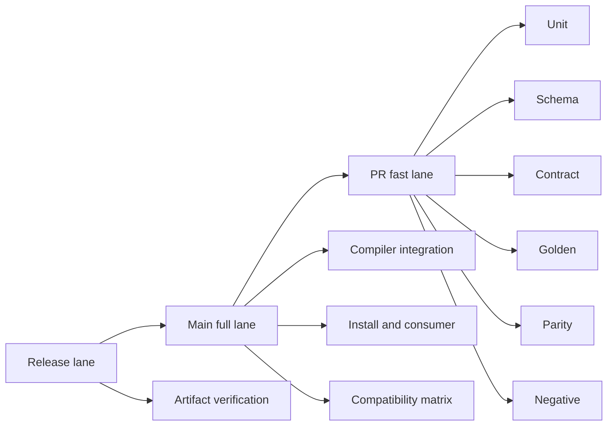

# Testing

Status: PROPOSED
Scope: Normative
Last updated: 2026-11-24

## Purpose

This document defines the test layers, shared fixtures, parity rules, and gates
for the MVP. The goal is to prove the contract, not only the implementation:
schema validity, model round-trips, deterministic `.typ`, cross-language parity,
compiler integration, and package installation.

## Current state

| Area | Current state |
|---|---|
| Test targets | Five `py_test` targets: `//tools/codegen/tests:unit_tests`, `//tools/publish/tests:publish_tests`, `//scripts/tests:version_tests`, `//scripts:docs_checks`, and `//specs/schemas:schema_tests`. |
| Test cases | Seven generator cases, 28 publisher cases, 10 release version cases, one documentation check, one schema bundle check. |
| Schema tests | `//specs/schemas:schema_tests` validates the built bundle. Meta-schema and instance validation are missing. |
| Publisher tests | `//tools/publish/tests:publish_tests` covers the publisher, the published identity of the built bundle, and the resolution of the versioned raw URLs. |
| Version tests | `//scripts/tests:version_tests` covers the release version check. |
| Contract tests | None. |
| Golden `.typ` tests | None. |
| Parity tests | None. |
| Compiler integration | None. |
| Install tests | None. |
| CI | The pull request and main lanes run the build, the test lane, the clean checkout build, and the documentation gate on Windows and Linux. |

The current `--test_filter` is ignored by the `py_test`; all seven cases run. Do
not rely on filtering for local iteration.

## Schema bundle test

`//specs/schemas:schema_tests` runs against the bundle that
`//specs/schemas:schema_bundle` produces, because the bundle is the
authoritative artifact set.

```shell
bazel test //specs/schemas:schema_tests
```

| Check | Rule |
|---|---|
| Encoding | UTF-8 JSON without a byte order mark. |
| Dialect | `$schema` is draft 2020-12. |
| Identity | An absolute, unique `$id` that matches the published versioned raw URL. |
| References | Every relative `$ref` resolves inside the bundle. |
| Closed objects | `additionalProperties: false` or `unevaluatedProperties: false`. |
| Required fields | A `required` list whose entries exist in `properties`. |
| Discriminators | A `type` discriminator with unique `const` values in every union. |

The prototype bundle does not satisfy the rules yet. The test therefore
compares each violation with the open prototype defects in
`specifications/schema.md`. An unexplained violation fails the target, and a
tracked violation that no longer occurs fails it too. The current result is 26
tracked violations across `SCH-D01`, `SCH-D03`, `SCH-D04`, `SCH-D05`,
`SCH-D06`, and `SCH-D10`.

## Test layers

| Layer | Purpose | Runs on |
|---|---|---|
| Unit | Generator, parser, validator, builder, emitter, diagnostics. | Every PR. |
| Schema | Meta-schema and instance validation. | Every PR. |
| Contract | Model serialization, deserialization, and round-trip. | Every PR. |
| Golden `.typ` | Exact emitter output for shared fixtures. | Every PR. |
| Cross-language parity | Python and TypeScript produce identical output and diagnostics. | Every PR. |
| Negative | Invalid schema, missing fields, unsafe paths, missing compiler, timeout. | Every PR for pure cases; compiler cases on main/release. |
| Compiler integration | Emit, workspace, Typst CLI, PDF validity. | Main and release; PR when Typst is available. |
| Install and consumer | Wheel and npm tarball in a clean environment. | Main and release. |
| Compatibility | OS, Python, Node, and Typst matrix. | Main and release. |

## Test lanes



## Shared fixtures

```text
tests/
  fixtures/
    documents/
      minimal.json
      report-small.json
      report-medium.json
      report-large.json
      invoice.json
      raw.json
    expected/
      minimal.typ
      report-small.typ
      report-medium.typ
      report-large.typ
      invoice.typ
      raw.typ
  contract/
  integration/
```

Rules:

- Fixtures are language-neutral JSON.
- Expected `.typ` files are shared by both SDKs.
- Fixtures cover every block and span type.
- Fixtures cover empty and optional fields.
- Fixtures cover Unicode text.
- Fixtures cover paths with `/` and Windows-normalized input.
- Fixtures cover raw content and module imports.
- A fixture change requires a review of expected output.

## Golden files

- Compare bytes, not normalized text.
- Expected files use UTF-8 without BOM and LF.
- Expected files end with one newline.
- Update a golden file only with an explicit explanation of the output change.
- A golden update that changes formatting without a semantic reason must be
  rejected.
- Golden files are not generated during the test run; they are reviewed source
  artifacts.

## Parity tests

For each shared fixture:

1. Deserialize the JSON in Python and TypeScript.
2. Validate both models.
3. Emit `.typ` from both.
4. Compare bytes.
5. Trigger the same negative case in both.
6. Compare diagnostics on code, severity, phase, path, location, details, and
   message.
7. Exclude raw compiler output from comparison.

The parity test must not compare implementation-specific object representations.

## Compiler integration

The compiler lane:

- Creates a temporary workspace.
- Copies assets.
- Runs `typst compile` with the supported version.
- Checks exit status.
- Checks the PDF header `%PDF-`.
- Checks that the PDF is non-empty.
- Checks that the requested output path exists when applicable.
- Checks that no partial output remains on failure.
- Runs with a timeout.

PDF bytes are not compared across platforms. Page count or visual regression is
Post-MVP unless a dependency-free check is available.

## Negative cases

| Case | Expected result |
|---|---|
| Unknown field | `TYPCAST-VAL-0002` |
| Missing required field | `TYPCAST-VAL-0001` |
| Invalid discriminator | `TYPCAST-VAL-0003` |
| Invalid heading level | `TYPCAST-VAL-0005` |
| Table shape mismatch | `TYPCAST-VAL-0007` |
| Duplicate module alias | `TYPCAST-VAL-0008` |
| Absolute asset path | `TYPCAST-VAL-0012` or `TYPCAST-IO-0003` |
| Path traversal | `TYPCAST-IO-0002` |
| Missing asset | `TYPCAST-IO-0001` |
| Missing compiler | `TYPCAST-COMPILER-0001` |
| Unsupported compiler | `TYPCAST-COMPILER-0002` |
| Compiler timeout | `TYPCAST-COMPILER-0003` |
| Compiler syntax error | `TYPCAST-COMPILER-0004` |
| Invalid output | `TYPCAST-COMPILER-0005` |

## Install and consumer tests

- Build a wheel and install it into a clean virtual environment.
- Import `typcast` and run a minimal document.
- Build an npm tarball and install it into a clean project.
- Import the package with ESM.
- Run a minimal TypeScript consumer.
- Verify that no development dependency is required at runtime.
- Verify package metadata and license files.

## Coverage and quality

The MVP uses critical-path coverage instead of a numeric threshold. The
following MUST be covered:

- Every public builder method.
- Every block and span type.
- Every diagnostic code.
- Every serialization path.
- Every compiler failure mode.
- Every asset rejection rule.

A numeric coverage percentage is not a release gate in the MVP. A coverage
threshold may be added in a later minor version once the suite stabilizes.

## Flaky tests

- Compiler tests must have a timeout and a deterministic fixture.
- Network access is not allowed in tests.
- Time-dependent output is not allowed.
- Tests must not depend on the order of parallel execution.
- A flaky test must be fixed or quarantined with an issue; it must not be
  silently retried.
- CI does not retry failed tests automatically. A quarantined test is reported
  separately from the pass/fail result and is tracked by an issue.
- A test that requires an automatic retry is `DEFERRED` to a later phase and
  must document why the retry is necessary.

## Requirements

| ID | Requirement | Status | Verification |
|---|---|---|---|
| TEST-001 | The MVP MUST have unit, schema, contract, golden, parity, compiler, install, and negative tests. | CONFIRMED | Test inventory. |
| TEST-002 | Shared fixtures MUST be language-neutral. | CONFIRMED | Fixture review. |
| TEST-003 | Golden tests MUST compare bytes. | CONFIRMED | Test implementation. |
| TEST-004 | Golden files MUST use UTF-8 without BOM and LF. | CONFIRMED | Byte check. |
| TEST-005 | Python and TypeScript MUST produce identical `.typ` output. | CONFIRMED | Parity test. |
| TEST-006 | Diagnostics parity MUST compare stable fields. | CONFIRMED | Parity test. |
| TEST-007 | Compiler integration MUST run on main and release. | CONFIRMED | CI review. |
| TEST-008 | Compiler integration MAY be skipped locally when Typst is missing. | CONFIRMED | Test behavior. |
| TEST-009 | Install tests MUST use a clean environment. | CONFIRMED | CI review. |
| TEST-010 | Negative tests MUST cover every documented diagnostic family. | CONFIRMED | Test inventory. |
| TEST-011 | Tests MUST NOT require network access. | CONFIRMED | CI review. |
| TEST-012 | Tests MUST NOT depend on execution order. | CONFIRMED | CI review. |
| TEST-013 | Flaky tests MUST be fixed or quarantined. | CONFIRMED | Process review. |
| TEST-014 | The MVP MUST use critical-path coverage instead of a numeric threshold, covering every public method, node type, diagnostic code, and failure mode. | CONFIRMED | Coverage inventory. |
| TEST-015 | CI MUST NOT retry failed tests automatically; quarantined tests MUST be reported separately and tracked by an issue. | CONFIRMED | CI review. |
| TEST-016 | Schema tests MUST validate the bundle and every `$ref`. | IMPLEMENTED | `//specs/schemas:schema_tests`; the one dangling reference is tracked as `SCH-D01` and fails the target when it is not listed. |
| TEST-017 | Contract tests MUST cover round-trip serialization. | CONFIRMED | Contract test. |
| TEST-018 | Tests MUST cover every block and span type. | CONFIRMED | Fixture review. |
| TEST-019 | Tests MUST cover Unicode and escaping. | CONFIRMED | Golden test. |
| TEST-020 | Tests MUST cover path traversal and absolute paths. | CONFIRMED | Negative test. |
| TEST-021 | Tests MUST cover compiler timeout and missing compiler. | CONFIRMED | Compiler test. |
| TEST-022 | Tests MUST cover partial output cleanup. | CONFIRMED | Failure test. |
| TEST-023 | Tests MUST cover package installation from wheel and npm tarball. | CONFIRMED | Install test. |
| TEST-024 | Test reports MUST be retained as CI artifacts for 14 days. | CONFIRMED | CI review. |
| TEST-025 | The test matrix MUST include Windows and Linux. | IMPLEMENTED | The build and test lanes of the workflows run on `windows-latest` and `ubuntu-latest`; the first run passed on both. |
| TEST-026 | The publisher MUST be covered by unit tests and by an integration test against the built bundle. | IMPLEMENTED | `//tools/publish/tests:publish_tests`; 28 cases. |
| TEST-027 | The release version check MUST be covered by unit tests. | IMPLEMENTED | `//scripts/tests:version_tests`; 10 cases. |
| TEST-028 | The resolution of the versioned raw URLs MUST be covered by a test that serves the published files from a local server. | IMPLEMENTED | `//tools/publish/tests:publish_tests`; the publisher tests use a local server, so the test suite needs no network access. |

## Open questions

- Should compiler tests run on PRs when Typst is available?
- Should PDF page count be checked in the MVP?
- Should visual regression be added before or after `1.0.0`?
- Should a numeric coverage threshold be introduced after the suite stabilizes?

## Related documents

- [Build](build.md)
- [Benchmarking](benchmarking.md)
- [CI/CD](ci-cd.md)
- [Document IR](../specifications/document-ir.md)
- [Diagnostics](../specifications/diagnostics.md)
- [ADR-0019](../decisions/ADR-0019-test-and-benchmark-policy.md)
