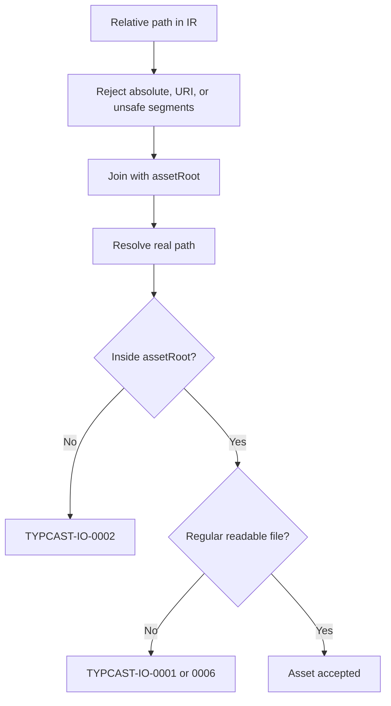

# Assets and modules

Status: CONFIRMED
Scope: Normative
Last updated: 2026-11-24

## Purpose

This document defines how Typcast resolves image files and Typst modules, how it
prevents path traversal, and how assets are placed in the compiler workspace.
The model uses portable relative paths; the SDK resolves them against an explicit
`assetRoot`.

## Asset root

`assetRoot` is a directory configured by the caller for validation and
compilation.

Rules:

- `assetRoot` MUST be an existing directory.
- It MUST be resolved to an absolute real path before use.
- It MUST be readable by the process.
- It MUST NOT be inferred from the current working directory.
- It MUST NOT be supplied by the document IR.
- A missing or invalid root produces `TYPCAST-CONFIG-0001`.

The builder can construct a document without an asset root. The root is required
when validating or compiling a document that contains images or modules.

## Path rules

All asset and module paths in the IR:

- Are relative.
- Use `/` as the separator.
- Contain no drive letter, UNC prefix, or URI scheme.
- Contain no empty, `.` or `..` segments.
- Contain no NUL or control characters.
- Are at most 1024 characters.
- Resolve inside `assetRoot`.

Examples:

| Path | Valid | Reason |
|---|---|---|
| `figures/revenue.png` | Yes | Relative and normalized. |
| `modules/format.typ` | Yes | Relative and normalized. |
| `../secret.png` | No | Traversal. |
| `/etc/passwd` | No | Absolute POSIX path. |
| `C:\reports\a.png` | No | Absolute Windows path. |
| `\\server\share\a.png` | No | UNC path. |
| `https://example.com/a.png` | No | Remote URL. |
| `data:image/png;base64,...` | No | Data URI. |
| `figures//a.png` | No | Empty segment. |
| `figures/./a.png` | No | Dot segment. |

The builder MAY accept backslashes on Windows and normalize them to `/`. The IR
itself MUST contain `/`.

## Resolution



Resolution steps:

1. Validate the path syntax.
2. Join the path to `assetRoot`.
3. Resolve the real path, following symlinks.
4. Compare the real path with the real `assetRoot`.
5. Reject if the result is outside the root.
6. Reject directories, devices, sockets, and other special files.
7. Reject unreadable files.
8. Record the normalized relative path for the workspace.

Case sensitivity follows the host filesystem. The SDK does not attempt to make
Windows paths case-sensitive.

## Symlinks

- Symlinks are allowed only when the resolved target remains inside `assetRoot`.
- A symlink pointing outside the root produces `TYPCAST-IO-0002`.
- A broken symlink produces `TYPCAST-IO-0001`.
- Symlink loops produce `TYPCAST-IO-0004`.
- The workspace copy uses the resolved file content, not the link itself.

## Modules

A module is a local `.typ` file imported at the top of the generated document.

Rules:

- `path` follows the same path rules as assets.
- The file MUST exist and be readable.
- The extension SHOULD be `.typ`; other extensions are allowed only if Typst
  accepts them.
- `alias` and `items` are mutually exclusive.
- `alias` MUST be a valid Typst identifier and unique in the document.
- `items` MUST contain valid identifiers and MUST NOT be empty when present.
- Module order is preserved in the emitted imports.
- Remote modules and Typst package imports are not supported in the MVP.
- Transitive local imports MUST be declared as modules so that they are copied
  into the workspace.
- The adapter does not discover transitive imports automatically.

Example:

```json
{
  "modules": [
    { "path": "modules/report.typ", "alias": "report" },
    { "path": "modules/format.typ", "items": ["currency", "percent"] }
  ]
}
```

## Workspace layout

The compiler workspace mirrors the relative paths from `assetRoot`:

```text
workspace/
  document.typ
  figures/
    revenue.png
  modules/
    report.typ
    format.typ
  packages/
  package-cache/
  output.pdf
```

Rules:

- `figures/revenue.png` is copied to `workspace/figures/revenue.png`.
- `modules/report.typ` is copied to `workspace/modules/report.typ`.
- The emitter writes `image("figures/revenue.png")`, not an absolute path.
- Duplicate normalized paths are copied once.
- Two different source files that normalize to the same destination are a
  conflict and produce `TYPCAST-IO-0004`.
- The workspace is removed after compilation.

## Limits

| Limit | Value | Status |
|---|---|---|
| Maximum path length | 1024 characters | CONFIRMED |
| Maximum raw node size | 1 MiB, configurable through `max_raw_bytes` | CONFIRMED |
| Maximum image size | 50 MiB per file | CONFIRMED |
| Maximum total copied assets | 500 MiB per compilation | CONFIRMED |
| Maximum module size | 10 MiB per file | CONFIRMED |

Limits are enforced before reading the full file where practical. A limit
violation produces `TYPCAST-IO-0004` or `TYPCAST-VAL-0010` with the limit in
`details`.

The asset limits are fixed values in the MVP. They are not configurable. A
future minor version may expose them through configuration; doing so requires a
schema and emitter review because the limits are part of the validated
contract.

## File types

- Images are passed to Typst; Typcast does not decode or transform them.
- The SDK does not execute or inspect module content.
- Executable files, archives, and device files are not supported as assets.
- MIME sniffing is not required in the MVP.
- A file that Typst cannot decode produces a compiler diagnostic, not an asset
  error.

## Security

- Path traversal is rejected before any read.
- Absolute paths are rejected before any read.
- Symlinks are resolved and checked.
- The compiler runs with `--root` set to the workspace.
- The adapter does not copy the entire `assetRoot`.
- The adapter copies only referenced files.
- Raw Typst can still access files inside the workspace; see
  `development/security.md`.
- Asset contents are not logged by default.

## Requirements

| ID | Requirement | Status | Verification |
|---|---|---|---|
| ASSET-001 | `assetRoot` MUST be explicit and resolved to a real directory. | CONFIRMED | Config test. |
| ASSET-002 | Asset and module paths MUST be relative and use `/`. | CONFIRMED | Schema test. |
| ASSET-003 | Absolute, UNC, URI, and data paths MUST be rejected. | CONFIRMED | Negative tests. |
| ASSET-004 | Empty, `.` and `..` segments MUST be rejected. | CONFIRMED | Negative tests. |
| ASSET-005 | Resolved paths MUST remain inside `assetRoot`. | CONFIRMED | Traversal test. |
| ASSET-006 | Symlinks MUST be checked after resolution. | CONFIRMED | Symlink test. |
| ASSET-007 | Special files MUST be rejected. | CONFIRMED | Negative test. |
| ASSET-008 | Missing assets MUST produce `TYPCAST-IO-0001`. | CONFIRMED | Negative test. |
| ASSET-009 | Module aliases MUST be unique identifiers. | CONFIRMED | Validation test. |
| ASSET-010 | Module alias and items MUST be mutually exclusive. | CONFIRMED | Validation test. |
| ASSET-011 | Module order MUST be preserved. | CONFIRMED | Golden test. |
| ASSET-012 | The workspace MUST mirror relative paths. | CONFIRMED | Workspace test. |
| ASSET-013 | Duplicate paths MUST be copied once. | CONFIRMED | Workspace test. |
| ASSET-014 | Conflicting destinations MUST fail. | CONFIRMED | Workspace test. |
| ASSET-015 | The workspace MUST be cleaned after compilation. | CONFIRMED | Workspace test. |
| ASSET-016 | The adapter MUST NOT copy the entire asset root. | CONFIRMED | Workspace test. |
| ASSET-017 | Asset limits MUST be enforced and documented: 1024-character paths, 50 MiB per image, 10 MiB per module, and 500 MiB per compilation. | CONFIRMED | Limit test. |
| ASSET-018 | Remote assets MUST NOT be supported. | CONFIRMED | Negative test. |
| ASSET-019 | Font paths, if added, MUST use the same resolution rules. | DEFERRED | Future review. |
| ASSET-020 | Asset resolution MUST NOT require network access. | CONFIRMED | Offline test. |

## Open questions

- Should the SDK support an explicit list of allowed file extensions?
- Should module transitive imports be discovered automatically?
- Should fonts be part of the first stable release?
- Should asset hashing be used for deduplication across compilations?

## Related documents

- [Document IR](document-ir.md)
- [Node catalog](nodes.md)
- [Compiler adapter](compiler.md)
- [Diagnostics](diagnostics.md)
- [Security](../development/security.md)
- [ADR-0017](../decisions/ADR-0017-resource-limits.md)
