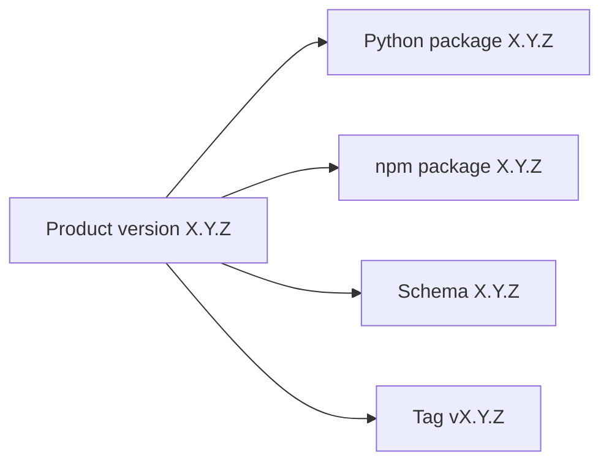

# Compatibility

Status: CONFIRMED
Scope: Normative
Last updated: 2026-11-24

## Purpose

This document defines the supported platform, runtime, compiler, and version
matrix for the MVP. A compatibility claim is valid only when it is verified by
the test matrix or explicitly marked as best-effort.

## Supported matrix

| Component | Supported | Tested | Status |
|---|---|---|---|
| Windows x64 | Yes | Local development | CONFIRMED |
| Linux x64 | Yes | CI target | CONFIRMED |
| macOS x64 or arm64 | Best-effort | Not a release gate | CONFIRMED |
| Python | 3.11, 3.12, 3.13, 3.14 | 3.11 to 3.14 in CI | CONFIRMED |
| Bazel Python toolchain | 3.14 | Local build | IMPLEMENTED |
| Node.js | 22 and 24 | CI matrix | CONFIRMED |
| TypeScript | 5.9.3 | Root `package.json` | IMPLEMENTED |
| Bazel | 9.3.3 | `.bazelversion` | IMPLEMENTED |
| Typst CLI | `>=0.15.0 <0.16.0` | 0.15.1 | CONFIRMED |
| Package versions | Lockstep SemVer | Release workflow | CONFIRMED |
| Schema version | Lockstep with product | Release workflow | CONFIRMED |
| Schema reference | Release-tag raw URL | Release workflow | CONFIRMED |

## Platform notes

### Windows x64

- The current development environment is Windows x64.
- Bazel output uses `x64_windows-fastbuild`.
- `.bazelrc` enables `startup --windows_enable_symlinks` unconditionally. The
  flag is required on Windows for the `typcast_schema_copy` symlink action.
  Linux CI must prove that Bazel starts with this flag; if the flag is rejected
  on Linux, it moves to a Windows-only rc file and Linux uses the default.
- Paths in the IR use `/`; the SDK normalizes Windows input where accepted.
- The compiler adapter resolves `typst.exe` and `PATHEXT`.
- Extended-length paths may appear in compiler diagnostics and are normalized
  for display.

### Linux x64

- Linux x64 is the primary server and CI target.
- The first Linux CI run verifies that `startup --windows_enable_symlinks` does
  not break Bazel startup.
- File permissions and symlink behavior follow the host filesystem.
- The compiler adapter resolves `typst` from `PATH`.

### macOS

- macOS is best-effort for the MVP.
- It is not a release gate.
- A macOS failure does not block a release, but it must be documented.
- A future minor release may promote macOS to supported after CI coverage.

## Runtime notes

### Python

- `pyproject.toml` declares `requires-python = ">=3.11"`.
- Bazel builds with a hermetic Python 3.14 toolchain.
- The SDK must not depend on CPython implementation details.
- Native extensions are not part of the MVP.
- A pure-Python wheel is expected to be platform-independent.
- The test matrix covers the minimum and current versions.

### Node.js and TypeScript

- `package.json` declares `node >= 22`.
- TypeScript compiler version comes from the root `package.json` through
  `aspect_rules_ts`.
- The package exposes ESM and type declarations.
- The package is ESM-only for `1.0.0`; CommonJS support is `DEFERRED`.
- Browser support is not tested in the MVP.
- The JavaScript package is compiled from TypeScript; there is no separate
  JavaScript implementation.

## Typst compatibility

- The supported range is one minor line.
- The initial tested version is 0.15.1.
- The adapter checks `typst --version` before compilation.
- A version outside the range fails with `TYPCAST-COMPILER-0002`.
- An explicit override is available for experimentation.
- Adding a new minor requires:
  1. A compatibility test run against all golden fixtures.
  2. A review of compiler diagnostics and output changes.
  3. A release note.
  4. An update to this matrix.
- Removing a supported minor is a breaking change for the SDK.

## Versioning relationship



Rules:

- Python, TypeScript, and schema versions share the same release number.
- The git tag is `vX.Y.Z`.
- Pre-releases use `vX.Y.Z-alpha.N` or `vX.Y.Z-beta.N`.
- A schema breaking change requires a major version.
- A package breaking change requires a major version.
- A Typst compatibility change may require a minor or major version depending on
  user impact.

## Schema version support

A reader supports:

- The same major version.
- A minor version less than or equal to its own.
- Any patch version within the supported minor.

A reader rejects:

- A newer major version.
- A newer minor version with unknown fields.
- A malformed version string.
- A missing `schemaVersion`.

Because objects are closed, a newer minor document is rejected by an older
reader when it contains new fields. This is intentional and must be documented in
release notes.

### Schema reference policy

A consumer selects one exact release tag and keeps using it:

```text
https://raw.githubusercontent.com/zuudevs/typcast/v1.0.0/specs/schemas/validator.schema.json
```

- A consumer MUST pin an exact release tag. It MUST NOT follow `main`, `HEAD`,
  or any floating branch.
- A consumer MUST NOT mix files from different tags. Every schema file and
  every `$ref` target comes from the same tag.
- A `main` URL is useful while authoring a consumer, but it is not a stable
  contract and MUST NOT be recorded as one.
- The repository has no release tag yet, so the tag URL above is illustrative.
- A newer major version is a breaking change. A consumer upgrades by changing
  its pinned tag and by following the release notes.

## Test matrix

| Lane | OS | Python | Node | Typst | Scope |
|---|---|---|---|---|---|
| PR fast | Windows, Linux | 3.11 and 3.14 | 22 | Optional | Unit, schema, contract, golden, parity. |
| Main full | Windows, Linux | 3.11 to 3.14 | 22 and 24 | 0.15.1 | Compiler, install, compatibility. |
| Release | Windows, Linux | 3.11 to 3.14 | 22 and 24 | 0.15.1 | Full gate and artifact verification. |

The exact CI matrix is defined in `development/ci-cd.md`.

## Current evidence

| Claim | Evidence | Status |
|---|---|---|
| Windows x64 build | `bazel build //...` succeeds. | IMPLEMENTED |
| Linux x64 build | No CI evidence yet. | OPEN |
| Python 3.11 | Manifest only; no CI evidence. | OPEN |
| Python 3.14 | Bazel toolchain and local build. | IMPLEMENTED |
| Node 22 | Manifest only; no CI evidence. | OPEN |
| Node 24 | No evidence. | OPEN |
| Typst 0.15.1 | Local `typst --version`. | IMPLEMENTED |
| macOS | No evidence. | DEFERRED |

## Requirements

| ID | Requirement | Status | Verification |
|---|---|---|---|
| COMPAT-001 | Windows x64 and Linux x64 MUST be supported and tested. | CONFIRMED | CI matrix. |
| COMPAT-002 | macOS MUST be best-effort and not a release gate. | CONFIRMED | Release review. |
| COMPAT-003 | Python 3.11 MUST be the minimum supported version. | CONFIRMED | CI matrix. |
| COMPAT-004 | Python 3.14 MUST remain the Bazel toolchain version until changed. | CONFIRMED | `MODULE.bazel`. |
| COMPAT-005 | Node.js 22 MUST be the minimum supported version. | CONFIRMED | CI matrix. |
| COMPAT-006 | TypeScript 5.9.3 MUST be the pinned compiler version. | CONFIRMED | Root `package.json`. |
| COMPAT-007 | Bazel 9.3.3 MUST be the pinned version. | CONFIRMED | `.bazelversion`. |
| COMPAT-008 | Typst 0.15.x MUST be the supported MVP range, tested with 0.15.1. | CONFIRMED | Compiler test. |
| COMPAT-009 | The compiler adapter MUST reject unsupported Typst versions. | CONFIRMED | Negative test. |
| COMPAT-010 | Adding a Typst minor MUST require a compatibility review. | CONFIRMED | Release review. |
| COMPAT-011 | Package and schema versions MUST be lockstep. | CONFIRMED | Release check. |
| COMPAT-012 | Pre-releases MUST use `vX.Y.Z-alpha.N` or `vX.Y.Z-beta.N`. | CONFIRMED | Tag check. |
| COMPAT-013 | A newer major schema version MUST be rejected. | CONFIRMED | Negative test. |
| COMPAT-014 | A newer minor schema version with unknown fields MUST be rejected. | CONFIRMED | Negative test. |
| COMPAT-015 | macOS support MUST be documented as best-effort. | CONFIRMED | Documentation review. |
| COMPAT-016 | Linux CI MUST prove that Bazel starts with the current `.bazelrc`; if the Windows symlink startup flag is rejected, it moves to a Windows-only rc file. | IMPLEMENTED | The first Linux CI run passed with the current `.bazelrc` on 2026-11-24. |
| COMPAT-017 | The npm package MUST be ESM-only for `1.0.0`; CommonJS support is DEFERRED. | CONFIRMED | Package and consumer tests. |
| COMPAT-018 | Browser support MUST be documented as untested. | CONFIRMED | Documentation review. |
| COMPAT-019 | A consumer MUST pin an exact schema release tag and MUST NOT use a `main` or floating reference as a stable schema reference. | CONFIRMED | Consumer documentation review. |

## Open questions

- Should macOS be promoted in a later minor release?
- Should the package support browsers or bundlers explicitly?
- Should Node.js 25 enter the matrix when it reaches general availability?

## Related documents

- [Vision and scope](../product/vision-and-scope.md)
- [Compiler adapter](compiler.md)
- [Release](../development/release.md)
- [CI/CD](../development/ci-cd.md)
- [ADR-0007](../decisions/ADR-0007-lockstep-semver.md)
- [ADR-0016](../decisions/ADR-0016-esm-only-npm-package.md)
- [ADR-0018](../decisions/ADR-0018-toolchain-and-ci-matrix.md)
- [ADR-0022](../decisions/ADR-0022-release-artifacts-schema-distribution-and-response-policy.md)
- [ADR-0023](../decisions/ADR-0023-schema-bundle-validation.md)
