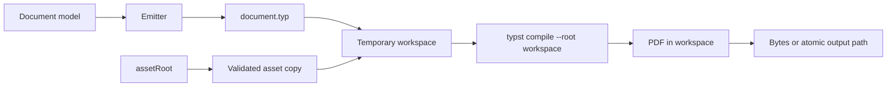

# Compiler adapter

Status: CONFIRMED
Scope: Normative
Last updated: 2026-11-24

## Purpose

The compiler adapter discovers an installed Typst CLI, checks its version,
compiles generated Typst source in an isolated workspace, and maps the result to
a `CompileResult` or a typed error. The MVP does not bundle or install the
compiler.

## Supported compiler

| Property | Value | Status |
|---|---|---|
| Backend | Typst CLI | CONFIRMED |
| Supported range | `>=0.15.0 <0.16.0` | PROPOSED |
| Tested version | `0.15.1` | PROPOSED |
| Override | Explicit `allow_unsupported_typst` flag | CONFIRMED |
| Retry | None | CONFIRMED |
| Default timeout | 60 seconds per document | CONFIRMED |

The supported range is one minor line. A new Typst minor release requires a
compatibility review, fixture compilation, and a release note before it is added
to the supported range.

## Discovery

The adapter resolves the compiler in this order:

1. The explicit `typst_path` configuration value.
2. The `typst` executable on `PATH`.

Rules:

- An explicit path must point to an executable file.
- On Windows, the adapter accepts `typst.exe` and resolves `PATHEXT`.
- The adapter does not invoke a shell.
- The adapter does not download or install the compiler.
- The adapter does not search arbitrary directories.
- A missing compiler produces `TYPCAST-COMPILER-0001`.

## Version check

The adapter runs:

```text
typst --version
```

The expected output starts with:

```text
typst 0.15.1
```

Rules:

- Parse the first semantic version in the output.
- Reject unparseable output with `TYPCAST-COMPILER-0006`.
- Reject a version outside the supported range with
  `TYPCAST-COMPILER-0002`.
- If `allow_unsupported_typst` is true, continue after recording a warning.
- The version check has a 10 second timeout.
- The detected version is recorded in `CompileResult.compiler_version` and in
  release metadata.

## Compilation

Command shape:

```text
typst compile --root <workspace> --format pdf --diagnostic-format short <input> <output>
```

Rules:

- Pass arguments as an array, never as a shell string.
- Set the working directory to the workspace.
- Set `--root` to the workspace so that absolute paths cannot escape it.
- Use `--format pdf` explicitly.
- Use `--diagnostic-format short` for parseable diagnostics.
- Do not pass user-controlled flags.
- Do not enable `--open`.
- Do not enable experimental features.
- Do not fetch Typst packages.
- Capture stdout and stderr separately.
- Apply the configured timeout.
- On timeout, terminate the process and produce
  `TYPCAST-COMPILER-0003`.
- On a non-zero exit, produce `TYPCAST-COMPILER-0004` with the raw output.
- On a zero exit, verify that the output file exists, is non-empty, and starts
  with `%PDF-`.
- If the output is missing or invalid, produce `TYPCAST-COMPILER-0005`.

## Workspace



The adapter creates a unique temporary directory for each compilation. The
workspace contains:

```text
workspace/
  document.typ
  figures/
  modules/
  packages/
  package-cache/
  output.pdf
```

Rules:

- Asset paths are copied preserving their relative structure.
- Module paths are copied preserving their relative structure.
- Duplicate normalized paths are copied once.
- The workspace is removed after success or failure.
- The output is read into memory or copied to the requested path before cleanup.
- The workspace path is not exposed as an absolute path in the `.typ` file.
- The adapter does not reuse a workspace across documents.

## Output handling

- If `output_path` is omitted, return PDF bytes in `CompileResult.pdf` and leave
  `CompileResult.path` unset.
- If `output_path` is provided, write the PDF atomically, return the path, and
  leave `CompileResult.pdf` unset.
- Create parent directories for the output path.
- Write to a temporary file in the destination directory and rename it into
  place.
- On failure, do not leave a partial PDF at the requested path.
- If the destination cannot be written, produce `TYPCAST-IO-0005`.

The overwrite policy for an existing destination is `PROPOSED` as atomic
overwrite. A future option may require explicit confirmation.

## Diagnostics

Typst short diagnostics use this shape:

```text
<path>:<line>:<column>: <severity>: <message>
```

The adapter:

- Maps `error` to `TYPCAST-COMPILER-0004`.
- Maps `warning` to a warning diagnostic with the same compiler code family.
- Extracts the file, line, and column into `Diagnostic.location`.
- Stores the raw line in `Diagnostic.details.raw`.
- Stores the exit code in `Diagnostic.details.exit_code`.
- Normalizes extended Windows paths for display.
- Preserves the compiler message without translation.
- Does not treat a warning as a failed compilation.

If a line cannot be parsed, the adapter still returns a compiler diagnostic with
the raw stderr in `details.raw` and no location.

## Security

- The compiler runs with the permissions of the calling process.
- `--root` limits Typst path access to the workspace.
- Raw Typst is trusted input; the adapter does not sandbox arbitrary Typst code.
- The adapter does not use a shell.
- The adapter does not fetch packages.
- Applications that accept untrusted raw Typst must add an external sandbox.
- The adapter does not read environment variables other than those needed to
  resolve the executable and temporary directory.
- The adapter does not log document content by default.

## Current state

There is no compiler adapter in the repository. No source file invokes Typst,
checks its version, or handles compiler diagnostics. The local development
machine has `typst 0.15.1`, which is the initial tested version.

## Requirements

| ID | Requirement | Status | Verification |
|---|---|---|---|
| COMP-001 | The adapter MUST use the Typst CLI as the only MVP backend. | CONFIRMED | Code review. |
| COMP-002 | The adapter MUST resolve an explicit path before `PATH`. | CONFIRMED | Discovery test. |
| COMP-003 | The adapter MUST NOT bundle or install Typst. | CONFIRMED | Dependency review. |
| COMP-004 | The adapter MUST check the compiler version before compilation. | CONFIRMED | Version test. |
| COMP-005 | The adapter MUST reject unsupported versions unless overridden. | CONFIRMED | Negative test. |
| COMP-006 | The adapter MUST invoke the compiler without a shell. | CONFIRMED | Command-capture test. |
| COMP-007 | The adapter MUST set `--root` to the workspace. | CONFIRMED | Command-capture test. |
| COMP-008 | The adapter MUST use `--diagnostic-format short`. | CONFIRMED | Command-capture test. |
| COMP-009 | The adapter MUST apply a configurable timeout. | CONFIRMED | Timeout test. |
| COMP-010 | The adapter MUST terminate the compiler on timeout. | CONFIRMED | Timeout test. |
| COMP-011 | The adapter MUST map non-zero exits to `TYPCAST-COMPILER-0004`. | CONFIRMED | Negative test. |
| COMP-012 | The adapter MUST map missing output to `TYPCAST-COMPILER-0005`. | CONFIRMED | Negative test. |
| COMP-013 | The adapter MUST validate the PDF header. | CONFIRMED | Compiler test. |
| COMP-014 | The adapter MUST copy assets into the workspace. | CONFIRMED | Workspace test. |
| COMP-015 | The adapter MUST clean the workspace after use. | CONFIRMED | Workspace test. |
| COMP-016 | The adapter MUST write output atomically. | CONFIRMED | Failure test. |
| COMP-017 | The adapter MUST NOT leave partial output on failure. | CONFIRMED | Failure test. |
| COMP-018 | The adapter MUST record the compiler version in the result. | CONFIRMED | Result test. |
| COMP-019 | The adapter MUST parse short diagnostics when possible. | CONFIRMED | Diagnostic test. |
| COMP-020 | The adapter MUST preserve raw compiler output in details. | CONFIRMED | Diagnostic test. |
| COMP-021 | The adapter MUST NOT fetch Typst packages. | CONFIRMED | Command review. |
| COMP-022 | The adapter MUST NOT retry automatically. | CONFIRMED | Behavior test. |

## Open questions

- What is the exact supported Typst range after the first compatibility run?
- Should timeout be configurable per operation or per document only?
- Should the adapter expose a pluggable compiler backend interface in the MVP?
- Should output overwrite require an explicit flag?
- Should the adapter set a reproducible creation timestamp for PDFs?

## Related documents

- [Architecture overview](../architecture/overview.md)
- [SDK API](sdk-api.md)
- [Diagnostics](diagnostics.md)
- [Assets and modules](assets.md)
- [Compatibility](compatibility.md)
- [Security](../development/security.md)
