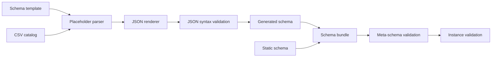
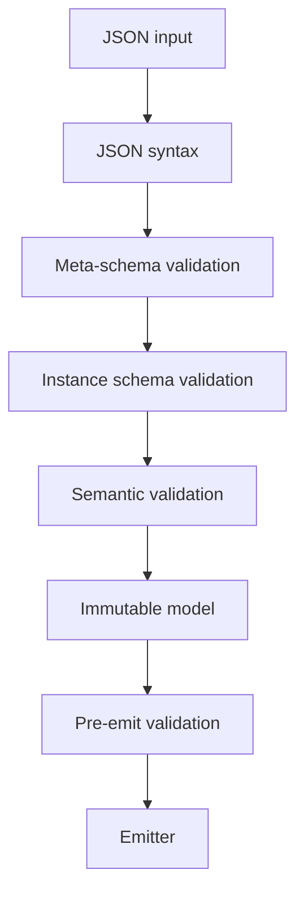

# Schema contract

Status: CONFIRMED
Scope: Normative
Last updated: 2026-11-24

## Purpose

This document defines how the Typcast JSON Schema contract is authored,
generated, validated, and versioned. The schema is normative for document data
and serialization. Builder ergonomics and emitter behavior are defined by the
SDK API and shared fixtures, not by JSON Schema alone.

The schemas in `specs/schemas/` implement the document IR of
`document-ir.md`. They are the normative data contract of the project. This
document defines how that contract is authored, generated, validated, and
versioned.

## Schema conventions

| Convention | Rule |
|---|---|
| Dialect | Every schema declares `$schema` with draft 2020-12. |
| Identity | Every schema declares an absolute `$id` that matches its published versioned raw URL. |
| Objects | Objects are closed with `additionalProperties: false` or `unevaluatedProperties: false`. |
| Required fields | Every object schema declares a `required` list, even when it is empty. Every required field is listed explicitly. |
| Null | `null` is allowed only when the field semantics are explicitly nullable. |
| Unions | Unions use a `type` discriminator with `const` values and `oneOf`. |
| Shared types | Shared shapes live in `$defs` or in a static schema file referenced by a relative `$ref`. |
| References | `$ref` paths must resolve in the validated artifact set. |
| Defaults | Defaults are documented in the schema but applied by the builder. |
| Extensions | Unknown fields are rejected. Raw Typst is the only escape hatch. |
| Unicode | Schema files are UTF-8 without a byte order mark. |

The canonical schema base URI is the versioned raw base
`https://raw.githubusercontent.com/zuudevs/typcast/<VERSION>/specs/schemas/`,
where `<VERSION>` is the Git release tag that publishes the schema. Every
published schema declares an `$id` equal to its own URL under that base, so a
relative `$ref` resolves to a sibling file at the same pinned tag.

The source schemas declare the same base with the contract version that they
implement, which is `1.0.0`. The release build substitutes the version once,
so the templates and the static schemas cannot drift. The decision is recorded
in ADR-0023.

```json
{
  "$id": "https://raw.githubusercontent.com/zuudevs/typcast/v1.0.0/specs/schemas/validator.schema.json"
}
```

Until the first release exists, that identifier names the contract and is not
a resolvable URL. The publisher writes the exact URL of the release tag, so a
published schema always names the tag that carries it.

## File layout

The target layout is:

```text
specs/
  catalogs/
    enums/
      alignment-values.csv
      length-suffixes.csv
      paper-variants.csv
  schemas/
    BUILD.bazel
    validator.schema.json
    api/
      types/
        alignment.schema.json.tmpl
        length.schema.json.tmpl
        paper.schema.json.tmpl
    definitions/
      bound.schema.json
      node.schema.json
```

`validator.schema.json` is the root schema for the MVP. A future major version
may rename it to `document.schema.json`; renaming is a breaking change for
consumers that fetch the schema by path.

The built bundle must preserve relative paths so that file-based `$ref` values
resolve. The current bundle is staged under `bazel-bin/specs/schemas/`.

## Schema distribution

Published schemas are served from the repository at the release tag. The
canonical URL of a schema file is:

```text
https://raw.githubusercontent.com/zuudevs/typcast/<VERSION>/specs/schemas/<SCHEMA_FILE>
```

| Part | Meaning |
|---|---|
| `<VERSION>` | The Git release tag that publishes the schema, for example `v1.0.0`. |
| `<SCHEMA_FILE>` | The path of the schema file relative to `specs/schemas/`. |

Rules:

- A release tag is immutable. The tag MUST NOT be moved, reused, or deleted.
  A correction ships in a new tag.
- A `main` URL is a development reference only. It MUST NOT be used as a
  stable reference and MUST NOT be published as one.
- Consumers pin an exact release tag. See `compatibility.md`.
- A breaking schema change requires a major version, so the pinned tag
  identifies the contract unambiguously.
- The MVP does not register, host, or operate a dedicated schema domain. No
  DNS, TLS, hosting, or renewal is required to publish a schema.
- The tagged commit contains the complete published bundle under
  `specs/schemas/`, so every schema file and every `$ref` target resolves at
  the same tag.

### Published paths

| Published path | Source | State |
|---|---|---|
| `specs/schemas/validator.schema.json` | `specs/schemas/validator.schema.json` | Tracked in the repository. |
| `specs/schemas/definitions/bound.schema.json` | `specs/schemas/definitions/bound.schema.json` | Tracked in the repository. |
| `specs/schemas/definitions/node.schema.json` | `specs/schemas/definitions/node.schema.json` | Tracked in the repository. |
| `specs/schemas/api/types/alignment.schema.json` | `specs/schemas/templates/api/types/alignment.schema.json.tmpl` | Generated by Bazel; published in the bundle. |
| `specs/schemas/api/types/length.schema.json` | `specs/schemas/templates/api/types/length.schema.json.tmpl` | Generated by Bazel; published in the bundle. |
| `specs/schemas/api/types/paper.schema.json` | `specs/schemas/templates/api/types/paper.schema.json.tmpl` | Generated by Bazel; published in the bundle. |

The generated files exist only in the build output today. The release commit
publishes them under `specs/schemas/`, which is what makes the versioned raw
URLs resolve. See `REL-030` in `development/release.md`.

### Example URLs

The repository has no release tag yet, so every tag URL below is illustrative:

```text
https://raw.githubusercontent.com/zuudevs/typcast/v1.0.0/specs/schemas/validator.schema.json
https://raw.githubusercontent.com/zuudevs/typcast/v1.0.0/specs/schemas/definitions/bound.schema.json
https://raw.githubusercontent.com/zuudevs/typcast/v1.0.0/specs/schemas/definitions/node.schema.json
```

The development reference for the same file is:

```text
https://raw.githubusercontent.com/zuudevs/typcast/main/specs/schemas/validator.schema.json
```

The `main` URL is not a stable reference. It changes whenever the branch
changes, and a consumer that pins a schema version MUST NOT use it.

## Generation pipeline



The generator:

- Resolves placeholder paths relative to the template directory.
- Accepts UTF-8 CSV with an optional BOM.
- Requires a header row.
- Rejects empty values in the selected column.
- Skips fully blank rows.
- Writes a parent directory when needed.
- Re-serializes JSON with two-space indentation.
- Validates JSON syntax only, not JSON Schema semantics or `$ref` resolution.
  The constants `NaN`, `Infinity`, and `-Infinity` are not valid JSON, so the
  generator rejects them instead of writing a file that every standard JSON
  parser refuses.

The generator does not validate that the generated schema is a valid JSON Schema.
That check belongs to the schema validation test layer.

## Bundle validation

`//specs/schemas:schema_tests` validates the built bundle. The bundle is the
authoritative artifact set, so the test runs against the build output and not
against the source tree.

```shell
bazel test //specs/schemas:schema_tests
```

| Rule | Requirement |
|---|---|
| Encoding | Every file is UTF-8 JSON without a byte order mark. |
| Dialect | Every file declares `$schema` draft 2020-12. |
| Identity | Every file declares an absolute, unique `$id` that matches its published versioned raw URL. |
| References | Every relative `$ref` resolves inside the bundle. |
| Closed objects | Every object schema sets `additionalProperties: false` or `unevaluatedProperties: false`. |
| Required fields | Every object schema declares a `required` list, and every listed field exists. |
| Discriminators | Every union uses a `type` discriminator with unique `const` values. |

The bundle satisfies every rule of this table, and the test fails on the first
violation. The test also checks that the bundle carries exactly the six
published files, so a schema cannot disappear from the artifact set unnoticed.

The test does not validate a schema document against the JSON Schema
meta-schema, and it does not validate an instance against the contract. Both
need a JSON Schema implementation that the repository does not depend on yet.

## Publishing

The published bundle is the file set that the tagged release commit carries
under `specs/schemas/`. `//tools/publish:publish_schemas` writes it.

```shell
bazel build //specs/schemas:schema_bundle //specs/schemas:schema_manifest
bazel-bin/tools/publish/publish_schemas.exe publish \
  --version v1.0.0 \
  --input bazel-bin/specs/schemas \
  --manifest bazel-bin/specs/schemas/schema_manifest.txt \
  --output specs/schemas
```

| Rule | Requirement |
|---|---|
| File set | The publisher publishes exactly the files of the bundle manifest. |
| Paths | Every published file keeps its path relative to `specs/schemas/`. |
| Identity | Every published file declares the `$id` of its versioned raw URL. |
| Version | The version MUST be a release tag. A `main` URL is a development reference and is rejected. |
| Encoding | Every published file is UTF-8 JSON with LF endings and a final newline. |

`//specs/schemas:schema_manifest` names the files of the bundle. The publisher
reads that list instead of scanning a directory, because the build directory
also holds the outputs of other rules.

The publisher rewrites the identity of a file, so the source schemas keep the
contract version in their identifier until the release replaces it with the
release tag.

The release lane compares the published bundle with the build before the tag
is created; see `development/release.md`.

## Placeholder syntax

```text
<relative/path/to/catalog.csv:ColumnName>
```

Every CSV used by a template must be listed in the Bazel rule's `catalogs`
attribute. Otherwise the sandbox will not provide the file and cache
invalidation will be incorrect.

## Validation pipeline



Semantic validation covers rules that JSON Schema cannot express cleanly:

- Table row and column count equality.
- Unique module aliases.
- Module alias and item exclusivity.
- Path normalization and traversal checks.
- Raw size limits.
- Schema version support.
- Date format beyond the annotation.

## Versioning

The schema follows SemVer:

| Change | Version impact |
|---|---|
| Remove a field, change a type, add a required field, change semantics | Major |
| Add an optional field, add a node type, add an enum value | Minor |
| Clarify documentation, fix a typo, improve a message | Patch |

The document IR carries `schemaVersion`. The reader:

- MUST reject an unsupported major version.
- MUST reject a minor version newer than the supported minor.
- MUST ignore patch differences after validating the supported schema.
- MUST NOT silently drop unknown fields.

Lockstep versioning means the schema version, Python package version, and npm
package version share the same release number. The mapping is `PROPOSED` as an
exact equality and `CONFIRMED` for the major version.

The source schemas carry the contract version in their identifier. The
publisher replaces it with the release tag, so the published identity and the
package versions stay in lockstep. A document carries its own `schemaVersion`
field, and the reader validates it against the supported range.

## Resolved prototype defects

The prototype bundle that the repository carried before the migration had ten
defects. All of them are closed. The normative IR in `document-ir.md` takes
precedence over the prototype files.

| ID | Defect | Resolution | Evidence |
|---|---|---|---|
| SCH-D01 | `node.schema.json` was missing. | `definitions/node.schema.json` defines the block union and the inline span union. | `//specs/schemas:schema_tests`; every relative `$ref` resolves. |
| SCH-D02 | `page.paper` was double nested. | `page` holds `paper`, `orientation`, and `margin` exactly once. | `validator.schema.json`; `IR-002`. |
| SCH-D03 | The `$id` did not match the output path. | Every schema uses the versioned raw base and its own published path. | `//specs/schemas:schema_tests`; the identity rule. |
| SCH-D04 | The root `$id` filename was wrong. | The root identity ends in `validator.schema.json`. | `validator.schema.json`; the identity rule. |
| SCH-D05 | `paper` and `length` lacked `$schema` and `$id`. | Every template declares the dialect and the identity. | `//specs/schemas:schema_tests`; the dialect and identity rules. |
| SCH-D06 | The objects were open and most of them declared no `required` list. | Every object is closed and declares its required fields. | `//specs/schemas:schema_tests`; the closed-object and required-field rules. |
| SCH-D07 | The source `$ref` values did not resolve without a build. | The built bundle is the authoritative artifact set and is self-contained. Source-tree resolution stays optional. | ADR-0023; `SCH-009`; the reference rule. |
| SCH-D08 | The relative length units were removed without replacement. | The IR keeps `%` and `fr` out of the MVP, and the catalog holds the five supported units. | `document-ir.md`; `IR-008`. |
| SCH-D09 | The root shape drifted from the target IR. | The root schema is rebuilt from `document-ir.md`: `schemaVersion`, `metadata`, `page`, `contents`, and `modules`. | `validator.schema.json`; `IR-001` to `IR-005`. |
| SCH-D10 | The schema identities used a local placeholder base. | Every identity uses the versioned raw base, and the publisher substitutes the release tag. | ADR-0022; ADR-0023; `SCH-002`. |

The bundle test no longer tracks violations. Every violation fails the target,
so a defect that returns fails the pull request lane.

## Generated type strategy

The MVP uses a hybrid approach:

- JSON Schema is the data contract.
- Python and TypeScript model types are written by hand for idiomatic APIs.
- Validators may be generated from the schema where practical.
- Builders and emitters are hand-written.
- Shared fixtures verify behavior that the schema cannot describe.

Full code generation of builders is not part of the MVP. This avoids coupling
the public API to JSON Schema limitations.

## Requirements

| ID | Requirement | Status | Verification |
|---|---|---|---|
| SCH-001 | Every schema MUST declare `$schema` draft 2020-12. | IMPLEMENTED | `//specs/schemas:schema_tests`; the dialect rule. |
| SCH-002 | Every schema MUST declare an absolute, unique `$id` that matches its published versioned raw URL. | IMPLEMENTED | `//specs/schemas:schema_tests`; the identity and uniqueness rules. |
| SCH-003 | Every object schema MUST be closed. | IMPLEMENTED | `//specs/schemas:schema_tests`; the closed-object rule. |
| SCH-004 | Every required field MUST be listed in `required`. | CONFIRMED | Schema lint and the required-field rule of the bundle test. |
| SCH-005 | Optional fields MUST be omitted rather than set to `null`. | CONFIRMED | Schema review. |
| SCH-006 | Unions MUST use a `type` discriminator with `const` values. | IMPLEMENTED | `//specs/schemas:schema_tests`; the discriminator rule. |
| SCH-007 | The root schema MUST validate the IR in `document-ir.md`. | CONFIRMED | Contract test. |
| SCH-008 | The built bundle MUST resolve every `$ref`. | IMPLEMENTED | `//specs/schemas:schema_tests`; the reference rule. |
| SCH-009 | The schema contract MUST be validated as a built bundle; source-tree `$ref` resolution is optional and MUST NOT be a release requirement. | IMPLEMENTED | `//specs/schemas:schema_tests` validates the bundle that `//specs/schemas:schema_bundle` produces. |
| SCH-010 | Every template CSV MUST be declared in the Bazel rule. | CONFIRMED | Build test. |
| SCH-011 | Empty CSV values in the selected column MUST be errors. | IMPLEMENTED | `test_empty_value_in_selected_column_reports_an_error`. |
| SCH-012 | Fully blank CSV rows MUST be skipped. | IMPLEMENTED | `test_fully_blank_rows_are_skipped`. |
| SCH-013 | Generated schemas MUST be deterministic. | CONFIRMED | Rebuild comparison. |
| SCH-014 | Schema changes MUST follow the versioning rules in this document. | CONFIRMED | Release review. |
| SCH-015 | `schemaVersion` MUST be validated against the supported range. | CONFIRMED | Negative test. |
| SCH-016 | The schema MUST reject unknown fields. | CONFIRMED | Negative test. |
| SCH-017 | The schema MUST reject invalid discriminators. | CONFIRMED | Negative test. |
| SCH-018 | The schema MUST reject missing required fields. | CONFIRMED | Negative test. |
| SCH-019 | The schema MUST be language-neutral and usable from Python and TypeScript. | CONFIRMED | Cross-language test. |
| SCH-020 | The prototype defects SCH-D01 to SCH-D10 MUST be resolved before 1.0.0. | IMPLEMENTED | The migration is complete; `//specs/schemas:schema_tests` reports no violation. |
| SCH-021 | A published schema MUST be referenced by the versioned raw URL of its release tag, and a `main` URL MUST NOT be used as a stable reference. | CONFIRMED | Release check. |

## Open questions

- Should the root schema be self-contained with `$defs`, or continue to use
  cross-file `$ref` values?
- Should generated TypeScript types be emitted from the schema, or maintained by
  hand for API ergonomics?
- Should the published bundle in the release commit be compared byte for byte
  with the Bazel build, or is schema validation with reference resolution
  enough?

## Related documents

- [Document IR](document-ir.md)
- [Node catalog](nodes.md)
- [Build](../development/build.md)
- [Release](../development/release.md)
- [Testing](../development/testing.md)
- [ADR-0002](../decisions/ADR-0002-hybrid-schema-and-builders.md)
- [ADR-0022](../decisions/ADR-0022-release-artifacts-schema-distribution-and-response-policy.md)
- [ADR-0023](../decisions/ADR-0023-schema-bundle-validation.md)
