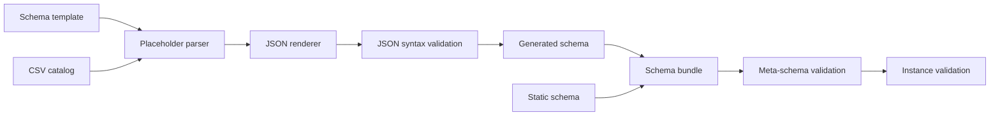
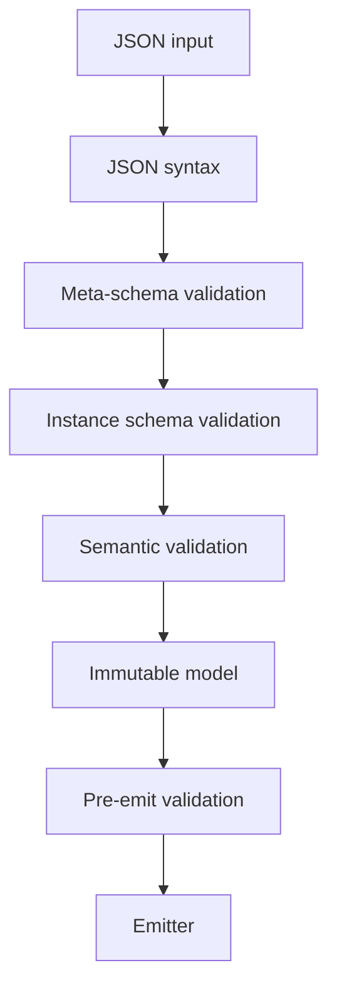

# Schema contract

Status: CONFIRMED
Scope: Normative
Last updated: 2026-11-24

## Purpose

This document defines how the Typcast JSON Schema contract is authored,
generated, validated, and versioned. The schema is normative for document data
and serialization. Builder ergonomics and emitter behavior are defined by the
SDK API and shared fixtures, not by JSON Schema alone.

The schemas currently in `specs/schemas/` are prototypes. They are not yet a
coherent public contract. This document defines the target and records the
migration work.

## Schema conventions

| Convention | Rule |
|---|---|
| Dialect | Every schema declares `$schema` with draft 2020-12. |
| Identity | Every schema declares an absolute `$id` that matches its published versioned raw URL. |
| Objects | Objects are closed with `additionalProperties: false` or `unevaluatedProperties: false`. |
| Required fields | Required fields are listed explicitly. Optional fields are omitted, not set to `null`. |
| Null | `null` is allowed only when the field semantics are explicitly nullable. |
| Unions | Unions use a `type` discriminator with `const` values and `oneOf`. |
| Shared types | Shared shapes live in `$defs` or in a static schema file referenced by a relative `$ref`. |
| References | `$ref` paths must resolve in the validated artifact set. |
| Defaults | Defaults are documented in the schema but applied by the builder. |
| Extensions | Unknown fields are rejected. Raw Typst is the only escape hatch. |
| Unicode | Schema files are UTF-8 without a byte order mark. |

The canonical schema base URI is the versioned raw base
`https://raw.githubusercontent.com/zuudevs/typcast/<VERSION>/specs/schemas/`,
where `<VERSION>` is the Git release tag that publishes the schema. Every
published schema declares an `$id` equal to its own URL under that base, so a
relative `$ref` resolves to a sibling file at the same pinned tag. The version
is substituted once by the release build so that templates and static schemas
cannot drift. The decision is recorded in ADR-0023.

## File layout

The target layout is:

```text
specs/
  catalogs/
    enums/
      alignment-values.csv
      length-suffixes.csv
      paper-variants.csv
  schemas/
    BUILD.bazel
    validator.schema.json
    api/
      types/
        alignment.schema.json.tmpl
        length.schema.json.tmpl
        paper.schema.json.tmpl
    definitions/
      bound.schema.json
      node.schema.json
```

`validator.schema.json` is the root schema for the MVP. A future major version
may rename it to `document.schema.json`; renaming is a breaking change for
consumers that fetch the schema by path.

The built bundle must preserve relative paths so that file-based `$ref` values
resolve. The current bundle is staged under `bazel-bin/specs/schemas/`.

## Schema distribution

Published schemas are served from the repository at the release tag. The
canonical URL of a schema file is:

```text
https://raw.githubusercontent.com/zuudevs/typcast/<VERSION>/specs/schemas/<SCHEMA_FILE>
```

| Part | Meaning |
|---|---|
| `<VERSION>` | The Git release tag that publishes the schema, for example `v1.0.0`. |
| `<SCHEMA_FILE>` | The path of the schema file relative to `specs/schemas/`. |

Rules:

- A release tag is immutable. The tag MUST NOT be moved, reused, or deleted.
  A correction ships in a new tag.
- A `main` URL is a development reference only. It MUST NOT be used as a
  stable reference and MUST NOT be published as one.
- Consumers pin an exact release tag. See `compatibility.md`.
- A breaking schema change requires a major version, so the pinned tag
  identifies the contract unambiguously.
- The MVP does not register, host, or operate a dedicated schema domain. No
  DNS, TLS, hosting, or renewal is required to publish a schema.
- The tagged commit contains the complete published bundle under
  `specs/schemas/`, so every schema file and every `$ref` target resolves at
  the same tag.

### Published paths

| Published path | Source | State |
|---|---|---|
| `specs/schemas/validator.schema.json` | `specs/schemas/validator.schema.json` | Tracked in the repository. |
| `specs/schemas/definitions/bound.schema.json` | `specs/schemas/definitions/bound.schema.json` | Tracked in the repository. |
| `specs/schemas/api/types/alignment.schema.json` | `specs/schemas/templates/api/types/alignment.schema.json.tmpl` | Generated by Bazel; published in the bundle. |
| `specs/schemas/api/types/length.schema.json` | `specs/schemas/templates/api/types/length.schema.json.tmpl` | Generated by Bazel; published in the bundle. |
| `specs/schemas/api/types/paper.schema.json` | `specs/schemas/templates/api/types/paper.schema.json.tmpl` | Generated by Bazel; published in the bundle. |

The generated files exist only in the build output today. The release commit
publishes them under `specs/schemas/`, which is what makes the versioned raw
URLs resolve. See `REL-030` in `development/release.md`.

### Example URLs

The repository has no release tag yet, so every tag URL below is illustrative:

```text
https://raw.githubusercontent.com/zuudevs/typcast/v1.0.0/specs/schemas/validator.schema.json
https://raw.githubusercontent.com/zuudevs/typcast/v1.0.0/specs/schemas/definitions/bound.schema.json
```

The development reference for the same file is:

```text
https://raw.githubusercontent.com/zuudevs/typcast/main/specs/schemas/validator.schema.json
```

The `main` URL is not a stable reference. It changes whenever the branch
changes, and a consumer that pins a schema version MUST NOT use it.

## Generation pipeline



The generator:

- Resolves placeholder paths relative to the template directory.
- Accepts UTF-8 CSV with an optional BOM.
- Requires a header row.
- Rejects empty values in the selected column.
- Skips fully blank rows.
- Writes a parent directory when needed.
- Re-serializes JSON with two-space indentation.
- Validates JSON syntax only, not JSON Schema semantics or `$ref` resolution.

The generator does not validate that the generated schema is a valid JSON Schema.
That check belongs to the schema validation test layer.

## Placeholder syntax

```text
<relative/path/to/catalog.csv:ColumnName>
```

Every CSV used by a template must be listed in the Bazel rule's `catalogs`
attribute. Otherwise the sandbox will not provide the file and cache
invalidation will be incorrect.

## Validation pipeline



Semantic validation covers rules that JSON Schema cannot express cleanly:

- Table row and column count equality.
- Unique module aliases.
- Module alias and item exclusivity.
- Path normalization and traversal checks.
- Raw size limits.
- Schema version support.
- Date format beyond the annotation.

## Versioning

The schema follows SemVer:

| Change | Version impact |
|---|---|
| Remove a field, change a type, add a required field, change semantics | Major |
| Add an optional field, add a node type, add an enum value | Minor |
| Clarify documentation, fix a typo, improve a message | Patch |

The document IR carries `schemaVersion`. The reader:

- MUST reject an unsupported major version.
- MUST reject a minor version newer than the supported minor.
- MUST ignore patch differences after validating the supported schema.
- MUST NOT silently drop unknown fields.

Lockstep versioning means the schema version, Python package version, and npm
package version share the same release number. The mapping is `PROPOSED` as an
exact equality and `CONFIRMED` for the major version.

## Current prototype defects

| ID | Defect | Evidence | Required action |
|---|---|---|---|
| SCH-D01 | `node.schema.json` is missing. | `validator.schema.json` references `./definitions/node.schema.json`; the file does not exist. | Add the node schema or remove the reference. |
| SCH-D02 | `page.paper` is double nested. | `validator.schema.json` and `paper.schema.json` both wrap `paper` and `margin`. | Define `page` once with `paper`, `orientation`, and `margin`. |
| SCH-D03 | `$id` does not match the output path. | `alignment` uses `/typst-api/types/...`; output is `api/types/...`. | Use the versioned raw base URI and consistent paths. |
| SCH-D04 | Root `$id` filename is wrong. | `validator.schema.json` declares `validation.schema.json`. | Make the `$id` match the published raw URL of the file, or rename the file. |
| SCH-D05 | `paper` and `length` lack `$schema` and `$id`. | Generated files omit both. | Add them in the templates. |
| SCH-D06 | Objects are open. | `bound`, `length`, `paper`, and `validator` do not set `additionalProperties: false`, and `length` and `paper` do not declare `required`. | Close objects and declare required fields. |
| SCH-D07 | Source `$ref` values do not resolve without a build. | `bound` and `validator` reference generated files that exist only in `bazel-bin`. | Make the validated bundle self-contained or provide source-resolvable refs. |
| SCH-D08 | Relative length units were removed without replacement. | `length-suffixes.csv` contains `pt`, `mm`, `cm`, `in`, `em`; `%` and `fr` are absent. | Keep them out of the MVP or add them with a versioned decision. |
| SCH-D09 | The root shape drifts from the target IR. | The prototype uses `version` instead of `schemaVersion`, `modules` is an object instead of an array, `contents` items are wrapped in a `call` object, and `metadata` is absent. | Rebuild the root schema from `document-ir.md`. |

These defects are `OPEN` until the schema migration is implemented. The
normative IR in `document-ir.md` takes precedence over the prototype files.
Replacing the placeholder identifiers with the versioned raw URLs is part of
that migration; the release build substitutes the version once.

## Generated type strategy

The MVP uses a hybrid approach:

- JSON Schema is the data contract.
- Python and TypeScript model types are written by hand for idiomatic APIs.
- Validators may be generated from the schema where practical.
- Builders and emitters are hand-written.
- Shared fixtures verify behavior that the schema cannot describe.

Full code generation of builders is not part of the MVP. This avoids coupling
the public API to JSON Schema limitations.

## Requirements

| ID | Requirement | Status | Verification |
|---|---|---|---|
| SCH-001 | Every schema MUST declare `$schema` draft 2020-12. | CONFIRMED | Meta-schema test. |
| SCH-002 | Every schema MUST declare an absolute, unique `$id` that matches its published versioned raw URL. | CONFIRMED | Schema lint. |
| SCH-003 | Every object schema MUST be closed. | CONFIRMED | Schema lint. |
| SCH-004 | Every required field MUST be listed in `required`. | CONFIRMED | Schema lint. |
| SCH-005 | Optional fields MUST be omitted rather than set to `null`. | CONFIRMED | Schema review. |
| SCH-006 | Unions MUST use a `type` discriminator with `const` values. | CONFIRMED | Schema lint. |
| SCH-007 | The root schema MUST validate the IR in `document-ir.md`. | CONFIRMED | Contract test. |
| SCH-008 | The built bundle MUST resolve every `$ref`. | CONFIRMED | Bundle test. |
| SCH-009 | The schema contract MUST be validated as a built bundle; source-tree `$ref` resolution is optional and MUST NOT be a release requirement. | CONFIRMED | Bundle validation test. |
| SCH-010 | Every template CSV MUST be declared in the Bazel rule. | CONFIRMED | Build test. |
| SCH-011 | Empty CSV values in the selected column MUST be errors. | IMPLEMENTED | `test_empty_value_in_selected_column_reports_an_error`. |
| SCH-012 | Fully blank CSV rows MUST be skipped. | IMPLEMENTED | `test_fully_blank_rows_are_skipped`. |
| SCH-013 | Generated schemas MUST be deterministic. | CONFIRMED | Rebuild comparison. |
| SCH-014 | Schema changes MUST follow the versioning rules in this document. | CONFIRMED | Release review. |
| SCH-015 | `schemaVersion` MUST be validated against the supported range. | CONFIRMED | Negative test. |
| SCH-016 | The schema MUST reject unknown fields. | CONFIRMED | Negative test. |
| SCH-017 | The schema MUST reject invalid discriminators. | CONFIRMED | Negative test. |
| SCH-018 | The schema MUST reject missing required fields. | CONFIRMED | Negative test. |
| SCH-019 | The schema MUST be language-neutral and usable from Python and TypeScript. | CONFIRMED | Cross-language test. |
| SCH-020 | The prototype defects SCH-D01 to SCH-D09 MUST be resolved before 1.0.0. | CONFIRMED | Migration review. |
| SCH-021 | A published schema MUST be referenced by the versioned raw URL of its release tag, and a `main` URL MUST NOT be used as a stable reference. | CONFIRMED | Release check. |

## Open questions

- Should the root schema be self-contained with `$defs`, or continue to use
  cross-file `$ref` values?
- Should generated TypeScript types be emitted from the schema, or maintained by
  hand for API ergonomics?
- Should the published bundle in the release commit be compared byte for byte
  with the Bazel build, or is schema validation with reference resolution
  enough?

## Related documents

- [Document IR](document-ir.md)
- [Node catalog](nodes.md)
- [Build](../development/build.md)
- [Release](../development/release.md)
- [Testing](../development/testing.md)
- [ADR-0002](../decisions/ADR-0002-hybrid-schema-and-builders.md)
- [ADR-0022](../decisions/ADR-0022-release-artifacts-schema-distribution-and-response-policy.md)
- [ADR-0023](../decisions/ADR-0023-schema-bundle-validation.md)
